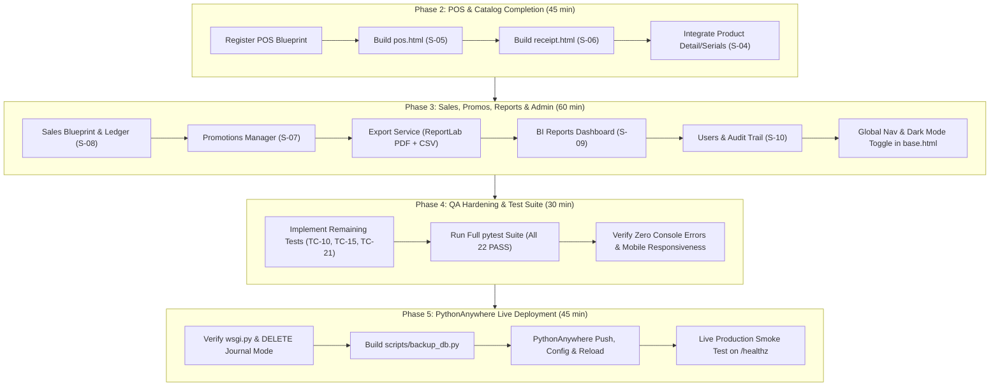

# Master Execution Plan: Ndungu Electronics IMS (To Phase 5 Completion)

**Plan ID:** `NE-PLAN-PHASE5-COMPLETION`  
**Execution Deadline:** 05:00 AM EAT  
**Target Goal:** Complete all 10 application screens, backend blueprints, ReportLab/CSV exports, 100% passing test suite (`TC-01` to `TC-22`), and prepare full deployment to **PythonAnywhere Free Tier**.

---

## 1. Timeline & Milestone Schedule

---

## 2. Phase-by-Phase Work Packages

### Phase 2: POS Register, Receipt Drawer & Product Detail
1. **Register `pos_bp`:** In `app/__init__.py`, import and register `pos_bp` under URL prefix `/pos`.
2. **Template `app/templates/pos.html` (S-05):**
   - Adapt `prototypes/stitch/s05_pos_register.html` using Rune design patterns.
   - Omnibar search (`Ctrl+K`), product list grid with stock badges, split-pane interactive cart.
   - Client-side VAT calculation (+16% post-discount subtotal preview), serial number selector for serialized items.
   - Cash / M-Pesa / Card tender modal.
3. **Template `app/templates/receipt.html` (S-06):**
   - Slide-over drawer with backdrop blur.
   - 80mm thermal receipt card layout with `@media print` rules for instant printing.
4. **Product Detail & Serial Intake (S-04):**
   - `/products/<int:id>` edit view with IMEI/serial chip repeater, stock adjustment, and soft-archive toggle.

### Phase 3: Sales Ledger, Promotions, BI Reports & Users
1. **Sales Ledger (`app/blueprints/sales.py` & `app/templates/sales.html` - S-08):**
   - Server-side paginated ledger (25 rows/page) sharing `WHERE` clause for total count.
   - Receipt lookup modal.
   - Owner-authorized sale voiding with inventory restitution and audit event.
2. **Promotions Manager (`app/blueprints/promotions.py` & `app/templates/promotions.html` - S-07):**
   - Active campaigns list, create promotion form (percentage, fixed KES off, BOGO).
   - Start/end date validation and toggle active/inactive.
3. **Export Service (`app/services/export_service.py`):**
   - **CSV Export:** Formula-safe (prepends `'` to `=, +, -, @, \t, \r`), emits UTF-8 BOM (`\ufeff`).
   - **PDF Export:** Pure-Python **ReportLab** generator for A4 daily sales and inventory valuation reports (PythonAnywhere compliant, no heavy C dependencies).
4. **BI Reports Dashboard (`app/blueprints/reports.py` & `app/templates/reports.html` - S-09):**
   - Daily sales summary, gross margin KPIs, top-selling products.
   - Low-stock reorder suggestions table (`< 5` threshold).
   - Instant buttons for "Export CSV" and "Download PDF Report".
5. **Users & Audit Trail (`app/blueprints/users.py` & `app/templates/users.html` - S-10):**
   - User list with role indicators, 24-hour single-use invite link generator with copy button.
   - Deactivate attendant switch, lockout reset button.
   - Audit trail table reading from `auth_events` and `stock_movements`.
6. **Unified Base Navigation (`app/templates/base.html`):**
   - Add full top navigation bar linking all pages: **Inventory**, **POS Register**, **Sales Ledger**, **Promotions**, **BI Reports**, **Users & Audit**.
   - Active state highlight at the blueprint prefix level (`/products/*` keeps Inventory active).
   - User pill showing role badge (`Owner` vs `Attendant`), logout button, and Dark Mode toggle.

### Phase 4: Full QA Hardening (22/22 Automated Tests)
1. **Extend Test Suite:**
   - Add `tests/test_sales.py`: `TC-10` (paginated sales count), `TC-13` (HTTP void with inventory restitution).
   - Add `tests/test_reports.py`: `TC-15` (CSV formula neutralization), `TC-16` (ReportLab PDF generation).
   - Add `tests/test_wsgi.py`: `TC-21` (WSGI app load, `FLASK_DEBUG=0`, DELETE journal mode, `/healthz` 200).
2. **Execute Full Suite:**
   - Run `pytest -v -p no:cacheprovider` — verify all **22 test cases pass**.

### Phase 5: PythonAnywhere Live Deployment
1. **Database Hot-Backup Script (`scripts/backup_db.py`):**
   - Implements SQLite `.backup()` hot-copy capped at 5 rolling snapshots to prevent disk exhaustion.
2. **PythonAnywhere Free Tier Verification:**
   - Verify `wsgi.py` points to production configuration (`DB_JOURNAL_MODE = "DELETE"`).
   - Ensure `requirements.txt` contains only runtime dependencies (`Flask`, `reportlab`, `python-dotenv`).
   - Document step-by-step bash commands to pull code, set up virtualenv, map `/static/` directory in Web tab, and reload the WSGI worker.
3. **Smoke Test:**
   - Check `GET /healthz` returns `200 {"status": "ok", "db": "ok"}`.
   - Log in live with `Augustin Sanga` and verify all 10 views render.
