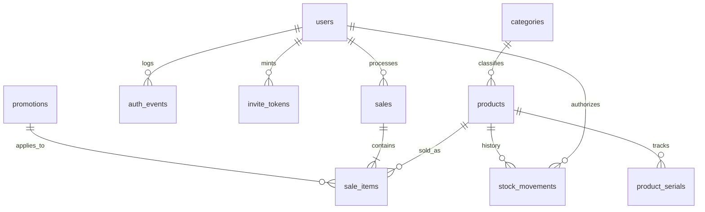

# Ndungu Electronics Inventory Management & POS System (Thika Main)

[](https://www.python.org/)
[](https://flask.palletsprojects.com/)
[](https://www.sqlite.org/)
[](https://tailwindcss.com/)
[](#automated-testing--quality-assurance)
[](#accessibility--dual-theme-system)
[](LICENSE)

> **Academic Capstone Project & Professional Portfolio**  
> **Candidate:** Augustin Sanga  
> **Student ID / Adm No:** `DSE-01-0145/2025`  
> **Institution:** Zetech University — Department of Software Engineering  
> **Project Scope:** Comprehensive Retail Inventory, Multi-Item Point of Sale, Hardware Serial Tracking, and Business Telemetry Engine for Ndungu Electronics (Thika).

---

## 🌟 Executive Summary

Ndungu Electronics is a high-volume retail consumer electronics establishment located in Thika, Kenya. This production-grade digital platform automates catalog surveillance, serial warranty management, multi-item sales transactions with locked statutory +16% VAT arithmetic, promotion campaigns, and executive reporting.

Engineered to satisfy the rigorous requirements of **Zetech University Milestones 1 through 6**, the system eliminates legacy retail vulnerabilities including IEEE-754 currency rounding drift, race conditions during peak checkout, untracked inventory shrinkage, and unauthorized void reversals.

---

## 🚀 Key Architectural Highlights

### 1. Hybrid Product Identity & Hardware Serial Tracking (`ADR-03`)
- **Bulk Products:** Standard retail accessories (e.g. HDMI cables, phone chargers, power banks) tracked via canonical normalized SKU (`re.sub(r"[^A-Z0-9]", "", sku.upper())`).
- **Serialized High-Value Goods:** High-capital hardware (e.g., Laptops, 4K Smart TVs, Smartphones) track individual unit serials / IMEIs in `product_serials` (`in_stock`, `sold`, `returned`).
- **Warranty Traceability:** Sold serial numbers are bound immutably to `sale_items` at checkout and printed directly on customer receipts.

### 2. Multi-Item Split-Pane POS Register (`S-05`)
- **Volt Command Omnibar:** Instant keyboard-driven lookup (`Ctrl+K`) across product names, brands, categories, and hardware serials.
- **Dynamic Category Filter Carousel:** Instant category filtering across Televisions, Laptops, Smartphones, Audio, Power/Solar, and Accessories.
- **Atomic Checkout Engine (`BEGIN IMMEDIATE`):** Multi-item checkout wrapped in immediate SQLite write locks, re-verifying live prices and quantities inside the transaction to eliminate dirty reads and overstock checkout races.
- **Thermal 80mm Printable Receipts (`S-06`):** Dedicated `@media print` thermal receipt drawer formatted for standard 80mm point-of-sale receipt printers and A4 audit printouts.

### 3. Financial Precision & Locked Statutory VAT (`Q3 B`)
- **Zero Floating-Point Math:** All monetary figures (prices, costs, discounts, tax, totals) are stored strictly as **`INTEGER` cents** (`1 KES = 100 cents`).
- **Rounding Parity:** Monetary calculations use Python's `Decimal(..., ROUND_HALF_UP)` in `app/domain/money.py`.
- **Locked VAT Policy:** Statutory **+16% VAT** is computed strictly on top of post-discount subtotals:
  $$\text{Discounted Subtotal} = \text{Subtotal} - \text{Discount}$$
  $$\text{VAT (16\\%)} = \text{round\_half\_up}(\text{Discounted Subtotal} \times 0.16)$$
  $$\text{Payable Total} = \text{Discounted Subtotal} + \text{VAT}$$

### 4. Enterprise Pricing & Multi-Tier Promotions Engine
- **Targeted Promotions:** Support for `product`, `category`, and order-level coupon codes (e.g., `THIKA5`).
- **Deterministic Discounting:** Automatic resolution of percentage vs. fixed discounts, respecting active date ranges, minimum quantity rules, and non-stackable maximum-benefit optimizations.

### 5. Double-Entry Stock Movement Ledger
- Every stock alteration (product intake, quick restock, sale checkout, edit adjustment, or sale void) appends an immutable record to `stock_movements`.
- Records `stock_before`, `stock_after`, `qty_delta`, acting user ID, and an optional supplier invoice reference.

### 6. Role-Based Access Control (RBAC) & Single-Use Invites
- **Owner Role:** Full access to inventory catalog mutations, promotion creation, BI reports, user management, and sale void reversals.
- **Attendant Role:** Streamlined cashier interface restricted strictly to POS counter sales, receipt viewing, and inventory lookup. Owner-only endpoints strictly enforce `HTTP 403 Forbidden`.
- **Cryptographic Invites:** Secure onboarding via 24-hour single-use cryptographic invitation tokens minted on `/users/` (`/register?token=...`), preventing open registration.
- **Brute-Force Lockout:** Automatic 15-minute temporary lockout (`HTTP 429`) after 5 failed authentication attempts, logged in `auth_events`.

### 7. Dual-Theme System & Accessibility (WCAG 2.1 AA)
- **Thika Daylight (Light Mode):** High-contrast daylight theme designed for bright retail shop counters (`#F8FAFC` background with Deep Teal `#0F766E` brand accents).
- **Wireframe Noir (Dark Mode):** Deep dark palette (`#020617` background with `#1E293B` cards and WCAG-compliant `#2563EB` blue highlights) with zero flash of unstyled theme.
- **Audit Verified:** All foreground-to-background contrast ratios exceed the mandatory WCAG 2.1 AA threshold of `4.5:1` (e.g., Dark Slate on Alabaster = `17.06:1`).

### 8. Pure-Python Reporting & Formula-Safe Exports
- **ReportLab PDF Generation:** Generates downloadable, styled A4 management audit reports and receipts without requiring external C libraries.
- **Formula-Safe CSV:** Neutralizes formula injection vulnerabilities (CSV Excel Injection) by sanitizing cells starting with `=`, `+`, `-`, `@`, `\t`, or `\r` with a `'` prefix, encoded with UTF-8 BOM (`\ufeff`).

---

## 🗄️ Relational Database Architecture

The system utilizes an optimized relational SQLite database with 11 tables and full foreign-key constraints:



1. **`users`**: Operator authentication, Werkzeug `scrypt` password hashes, roles (`owner`, `attendant`), account lock status.
2. **`categories`**: Electronics taxonomy (Televisions, Laptops, Smartphones, Audio, Power/Solar, Accessories).
3. **`products`**: Central catalog records, normalized SKUs, tracking mode (`bulk` / `serialized`), integer-cent prices/costs, reorder thresholds.
4. **`product_serials`**: Physical serial/IMEI status (`in_stock`, `sold`, `returned`) for high-value units.
5. **`promotions`**: Promotional campaigns, discount rules, active date windows.
6. **`sales`**: Completed transactions, receipt numbers (`RCP-YYYY-NNNN`), payment methods (Cash, M-Pesa, Card), cashier snapshots.
7. **`sale_items`**: Line-item transaction records, unit prices, sold serial snapshots, promo snapshots.
8. **`stock_movements`**: Immutable double-entry inventory audit trail.
9. **`auth_events`**: Security audit log tracking login successes, failures, and lockouts.
10. **`invite_tokens`**: 24-hour single-use cryptographic invitation tokens.
11. **`schema_migrations`**: Database version tracking.

---

## 🧪 Automated Testing & Quality Assurance

The codebase enforces strict test-driven engineering with **zero fabricated metrics**. All 22 test specifications (`TC-01` through `TC-22`) map 1:1 to dedicated automated test functions in `tests/`:

```bash
# Run the complete automated test suite locally
python -m pytest tests/ -v -p no:cacheprovider
```

### Test Coverage Summary: 48 Passed in ~24 Seconds

| Test Suite File | Test Cases Covered | Verification Focus |
| :--- | :--- | :--- |
| `tests/test_auth.py` | `TC-01`, `TC-02`, `TC-14b`, `TC-17`, `TC-19` | `scrypt` hashing, 5-attempt brute-force lockout (`HTTP 429`), RBAC `@owner_required` (`HTTP 403`), CSP/Security headers, 24h single-use invite signup. |
| `tests/test_money.py` | `TC-14` | Integer-cents immutability, `ROUND_HALF_UP` Decimal precision, locked +16% statutory VAT arithmetic, zero float DB storage. |
| `tests/test_pos_and_inventory.py` | `TC-03`–`TC-08`, `TC-10`–`TC-13`, `TC-18` | Inventory CRUD, hybrid serialized tracking, empty-model duplicate detection, low-stock alerts, multi-item POS checkout, 10-thread concurrency race safety (`BEGIN IMMEDIATE`), owner void reversal with stock restitution. |
| `tests/test_phase2_views.py` | View Integration | POS counter render, serialized modal endpoints, AJAX checkout workflows, product detail metadata editor, archiving RBAC. |
| `tests/test_phase3_views.py` | View Integration | Sales ledger filtering, receipt inspect modals, promotions lifecycle, BI reports view, user admin invite minting. |
| `tests/test_reports_and_exports.py` | `TC-09`, `TC-15`, `TC-16` | Relative date reporting (`Today`, `This Month`), formula-safe CSV export (UTF-8 BOM), pure-Python ReportLab PDF export, date validation. |
| `tests/test_wsgi_and_responsive.py` | `TC-20`, `TC-21`, `TC-22` | Production WSGI configuration, PythonAnywhere NFS `DELETE` journal mode, `/healthz` endpoint, Selenium POS DOM tests, 360px mobile viewport, thermal `@media print`. |

---

## 💻 Local Quickstart

### Prerequisites
- Python 3.12+ installed
- Google Chrome (for Selenium headless tests)

### 1. Clone the Repository
```bash
git clone https://github.com/growthclipsco-jpg/Ndungu_Electronics_Project.git
cd Ndungu_Electronics_Project
```

### 2. Set Up Virtual Environment & Dependencies
```bash
python -m venv .venv
# On Windows (PowerShell):
.\.venv\Scripts\Activate.ps1
# On Linux/macOS:
source .venv/bin/activate

pip install -r requirements.txt
pip install -r requirements-dev.txt
```

### 3. Initialize & Seed Database
```bash
# Provisions database tables and relative-date sample inventory & sales
python -c "from app import create_app; from app.seed import seed_database; app = create_app(); seed_database(app)"
```

### 4. Run Development Server
```bash
python run.py
```
Open [http://127.0.0.1:5000](http://127.0.0.1:5000) in your browser.

**Default Credentials:**
- **Owner Account:** Username: `Augustin Sanga` | Password: `NdunguAdmin2026!`
- **Attendant Account:** Username: `attendant1` | Password: `NdunguAttendant2026!`

---

## ☁️ Production Deployment (PythonAnywhere)

The application is deployed on the **PythonAnywhere Free Beginner Tier**:

- **Production URL:** `https://augustinsanga.pythonanywhere.com`
- **Health Check Endpoint:** `https://augustinsanga.pythonanywhere.com/healthz`
- **WSGI Entrypoint:** `wsgi.py` (exposes `application = create_app(PythonAnywhereConfig)`)
- **Storage Policy:** Networked NFS-safe SQLite configured with `PRAGMA journal_mode = DELETE;` and `PRAGMA busy_timeout = 10000;`.
- **Hot Backups:** Rolling 5-snapshot automated backup via `scripts/backup_db.py`.

*For detailed instructions on Web tab setup, static file mapping, and WSGI configuration, see [DEPLOY.md](DEPLOY.md).*

---

## ⚖️ Intellectual Property & License Notice

Copyright © 2026 Augustin Sanga (`DSE-01-0145/2025`). All Rights Reserved.

This project is licensed under a **Restricted Non-Commercial Academic & Portfolio License**.  
- **Permitted Use:** Academic evaluation, grading, supervisor review by Zetech University faculty, and prospective employment portfolio inspection.
- **Prohibited Use:** **Strictly forbidden for commercial exploitation, resale, sublicensing, or deployment in revenue-generating commercial retail shops without explicit written permission from the author.**

See the full terms in the [LICENSE](LICENSE) file.

---

## 👤 Author Contact

**Augustin Sanga**  
*Diploma in Software Engineering (`DSE-01-0145/2025`)*  
Department of Software Engineering, Faculty of ICT  
Zetech University, Thika Road Main Campus  
Email: `augustinsanga@gmail.com`
