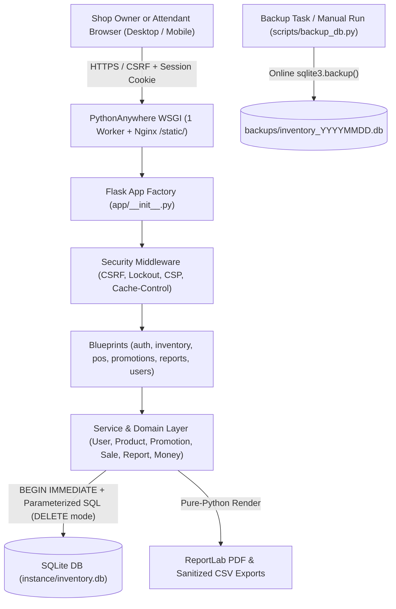
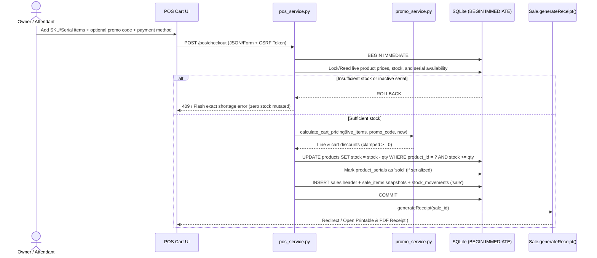
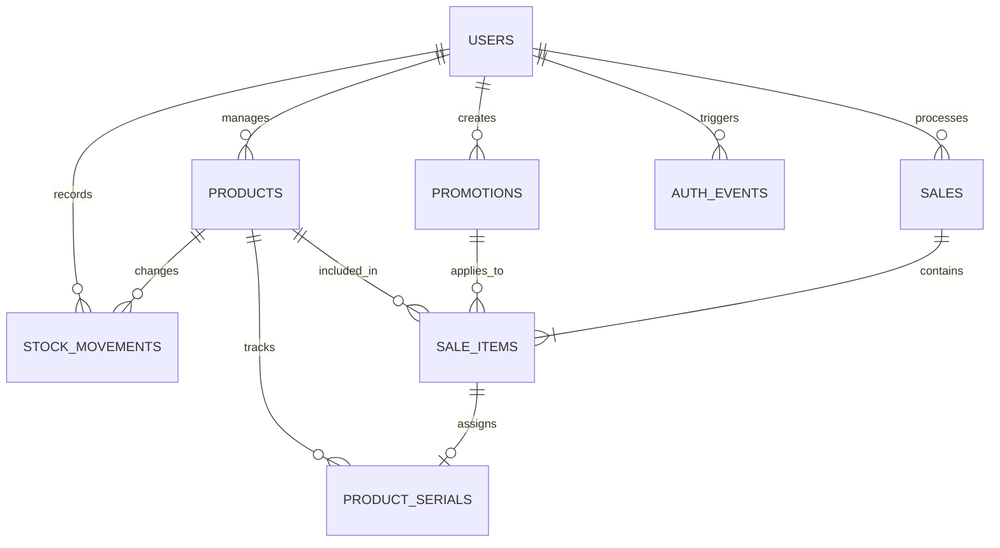

# Implementation Plan: Ndungu Electronics Inventory Management System (A-Grade Rebuild)

**Document ID:** `NE-IMS-PLAN-v2.0`  
**Date:** 2026-11-13  
**Author:** `plan-architect` (incorporating findings from [audit.md](file:///C:/Users/Sanga/Documents/Ndungu_Electronics_Project/audit.md) & engineering research)  
**Target Workspace:** `C:\Users\Sanga\Documents\Ndungu_Electronics_Project`  
**Student & Academic Context:** Augustin Sanga (`DSE-01-0145/2025`), Zetech University — *A Digital Inventory Management System for Ndungu Electronics, Thika*  
**Document Status:** **Approved & Locked for Phase-by-Phase Execution (Phase 0 Ready)** *(User `/grill` decisions locked; Phase 5 finalized on PythonAnywhere Free Beginner Tier + full [AGENTS.md](file:///C:/Users/Sanga/Documents/Ndungu_Electronics_Project/AGENTS.md) production guideline book).*

---

## Scope & Non-Goals

To prevent scope creep while guaranteeing 100% alignment with Zetech University Milestones 1–6 and retail reliability in Thika:

- **In Scope:**
  - Single-outlet retail electronics inventory & POS system for Ndungu Electronics (Thika), accessible via desktop, laptop, and mobile browsers.
  - Full inventory CRUD, restocking, category management, hybrid bulk SKU vs. per-unit serial tracking, and smart duplicate prevention.
  - Multi-item POS cart checkout with atomic SQLite stock deduction, Cash / M-Pesa / Card payment logging, Promotion & Pricing engine, and printable/PDF receipt generation (`Sale.generateReceipt()`).
  - Real-time low-stock surveillance (`< 5` default + configurable per-product thresholds) and actionable reorder suggestions.
  - Multi-attribute search, server-side pagination, BI analytics reports, CSV (formula-safe UTF-8 BOM) and pure-Python PDF exports, and full stock/auth audit logging.
  - Role-Based Access Control (`owner` & `attendant`), owner-issued invite sign-up flow, session security hardening, rate limiting/account lockout, and password management.
  - Live deployment configuration for **PythonAnywhere Free Beginner Tier** (WSGI `wsgi.py`, 512 MiB disk-quota hygiene, NFS-safe `DELETE` SQLite locking, backup script) plus aligned Milestone 1–6 academic documentation artifacts and a dedicated [AGENTS.md](file:///C:/Users/Sanga/Documents/Ndungu_Electronics_Project/AGENTS.md) production guideline book.
- **Explicit Out of Scope (v1.0):**
  - Multi-branch distributed inventory synchronization across separate physical shops.
  - Direct Safaricom Daraja API STK-Push or real-time M-Pesa webhook integration *(v1 records M-Pesa confirmation references manually at checkout)*.
  - KRA eTIMS / TIMS physical fiscal tax control unit hardware integration *(v1 optionally tracks tax-inclusive or configurable VAT display lines on receipts without claiming statutory eTIMS transmission)*.
  - Native Android/iOS binaries *(covered via responsive mobile-first web UI per Milestone 1 §1.5)*.

---

## 1. Executive Summary & A-Grade Strategy

### 1.1 Lessons Learned from the Legacy `App/` Attempt

Forensic inspection in [audit.md](file:///C:/Users/Sanga/Documents/Ndungu_Electronics_Project/audit.md) established that the prior [App/](file:///C:/Users/Sanga/Documents/Ndungu_Electronics_Project/App) prototype fails both **academic rubric compliance** and **production engineering reliability**, despite its trivial single-function test passing (`pytest App/test_system.py -v` executes only `test_system_flow_objectives`). Specifically, the rebuild must eliminate seven systemic defects:

1. **Unimplemented Core Requirements:** Milestone 1 Table 1.4.1 row 6 (`Pricing and promotion management`) and Milestone 2 Figure 1.3.6 (`Sale.generateReceipt()` and `Sale` `contains *` `Product` multi-item association) are completely absent in `App/`, alongside CSV/PDF exports and PythonAnywhere WSGI files (`wsgi.py`, `requirements.txt`).
2. **Broken Out-of-the-Box Experience on Current Dates:** [App/seed.py](file:///C:/Users/Sanga/Documents/Ndungu_Electronics_Project/App/seed.py#L55-L60) hardcodes sales to `2026-10-21`–`2026-10-23`, causing `/inventory` (`Today's sales`) and `/reports` (default `This month`, `Today`, `Last 7 days`) to display **`Kes. 0`** in November 2026.
3. **Flawed Product Identity & Duplicate Logic:** `App/` stores bulk `stock = 12` under one `serial_no` while [App/app.py](file:///C:/Users/Sanga/Documents/Ndungu_Electronics_Project/App/app.py#L289-L307) (`find_duplicate()`) blocks distinct products whenever optional `model` is blank (`""`), and `normalize_serial()` preserves inconsistent whitespace/hyphens.
4. **Floating-Point Money & Concurrency Races:** `REAL`/`float` storage risks IEEE-754 rounding drift once discounts or VAT are introduced; [App/app.py](file:///C:/Users/Sanga/Documents/Ndungu_Electronics_Project/App/app.py#L531-L566) (`sell_product()`) reads price and stock *before* the `UPDATE` and runs SQLite in `DELETE` mode without `busy_timeout` or `BEGIN IMMEDIATE`.
5. **Misleading Test Claims & Stale Paths:** [Milestone_3_Development_and_Testing.pdf](file:///C:/Users/Sanga/Documents/Ndungu_Electronics_Project/Milestone_3_Development_and_Testing.pdf) Table 3.2 claims 9 automated `PASS` tests (`TC-01`–`TC-09`) while [App/test_system.py](file:///C:/Users/Sanga/Documents/Ndungu_Electronics_Project/App/test_system.py#L53-L130) omits `TC-02` (RBAC `403`) and `TC-08` (over-stock block) entirely; Section 3.6 and [App/generate_m3_doc.py](file:///C:/Users/Sanga/Documents/Ndungu_Electronics_Project/App/generate_m3_doc.py#L364) cite a deleted scratch directory; [App/run_system.bat](file:///C:/Users/Sanga/Documents/Ndungu_Electronics_Project/App/run_system.bat#L16) hardcodes a local Python 3.12 path.
6. **Security & UI Gaps:** `FLASK_DEBUG=1` default ([App/app.py](file:///C:/Users/Sanga/Documents/Ndungu_Electronics_Project/App/app.py#L685-L686)), missing HTTP security headers, no login throttling/lockout, committed `instance/secret_key` without `.gitignore`, unstyled CSS classes (`.flash-warning`, `.row-low`, `.tabs`, `.stat-hero`, `.table.compact`), nav active highlight drop on `/products/*` sub-routes ([App/templates/base.html](file:///C:/Users/Sanga/Documents/Ndungu_Electronics_Project/App/templates/base.html#L14)), redundant per-request low-stock query in `inject_globals()`, and zero `@media` responsive or `@media print` rules in [App/static/style.css](file:///C:/Users/Sanga/Documents/Ndungu_Electronics_Project/App/static/style.css).
7. **Academic Documentation Drift:** Blank author and conflicting degree title (`Diploma in Computer Science` vs. `Diploma in Software Engineering`) on Milestone 1 cover, orphaned `TABLE 1.6.1`, blank page 13, `1.x` heading numbering inside Chapter Two (`.docx` `Caption` paragraphs show `Figure 2.2.1`–`2.3.6` while PDF export restarts `Heading 1` numbering at `1`), `Sec 3.1`/`3.3.6` `PBKDF2:SHA256` (and `Table 3.1` `PBKDF2`) vs. actual `scrypt:32768:8:1` hashes in `inventory.db`, and unmodeled screens/roles.

### 1.2 Alignment with Zetech University Milestone 1–6 Assessment Sheets

Inspection of [Milestone_1_and_2_Sheet_1.png](file:///C:/Users/Sanga/Documents/Ndungu_Electronics_Project/Milestone_Instructions/Milestone_1_and_2_Sheet_1.png), [Milestone_3_to_5_Sheet.png](file:///C:/Users/Sanga/Documents/Ndungu_Electronics_Project/Milestone_Instructions/Milestone_3_to_5_Sheet.png), and [Milestone_5_and_6_Sheet.png](file:///C:/Users/Sanga/Documents/Ndungu_Electronics_Project/Milestone_Instructions/Milestone_5_and_6_Sheet.png) establishes the exact grading rubric our architecture and roadmap satisfy:

| Milestone | Sheet Criteria (`Milestone_Instructions/*.png`) | Observed Sheet Weight | Strategy to Secure Full Marks |
| :--- | :--- | :--- | :--- |
| **M1: Planning & Analysis** | Problem statement, justification, objectives, tools/resources, Gantt schedule → Coverpage & Ch. 1 | `Score /10` | Fix cover author (`AUGUSTIN SANGA`, `DSE-01-0145/2025`), unify programme (`Diploma in Software Engineering`), add Objective VI (Pricing & Promotions), populate `Table 1.6.1`, remove blank page 13, align Gantt timeline. |
| **M2: Project Design** | UI rough sketches for **all** screens, process/logic models & ERD → Ch. 2 | `Score /20` | Fix `1.x` → `2.x` figure/section numbering; export **all 10 UI screens** from Google Stitch; update Flowchart, Context/L1 DFD (removing invalid `2 MANAGE INVENTORY` ↔ `D1 user db` edge and wiring `D2 product db` → `4 GENERATE REPORTS`), Use Case, ERD, and Class Diagram to include `attendant`, `SaleItem`, `Promotion`, `StockMovement`, and `generateReceipt()`. |
| **M3: Dev & Testing (1/2)** | Practical build, feature-by-feature dev/debug, DB integration → Ch. 3 | `Score /20` | Deliver clean modular Flask + normalized SQLite schema, document real debugging resolutions accurately (including `scrypt` / `PBKDF2` honesty), and ensure every `TC-xx` row maps to a real passing `pytest` test. |
| **M4: Dev & Testing (2/2)** | Advanced features, debugging, DB integration → Ch. 3 | `Score` *(denominator cropped; inferred `/20`)* | Complete multi-item POS cart, `generateReceipt()`, Pricing & Promotion engine, CSV/PDF exports, Stock Audit Log, and Selenium browser E2E checks. |
| **M5: Deployment** | Launch in simulated/real environment; test features live in deployment environment → Ch. 3 | `Score /20` | Deploy live to **PythonAnywhere Free Beginner Tier** (`wsgi.py`, HTTPS, NFS-safe `DELETE` SQLite, env vars, 512 MiB quota hygiene), verify every core flow on the live `https://augustinsanga.pythonanywhere.com` URL, and embed live deployment evidence + smoke checklist in Ch. 3. |
| **M6: Final Touches** | Preliminary pages (`i–v`), Ch. 4 Conclusions & Recommendations, APA 7 References | `Score` *(denominator cropped; inferred `/10`, `TOTAL` inferred `/100`)* | Replace every `"LEAVE BLANK TILL AFTER COMPLETION"` page (`Declaration`, `Dedication`, `Acknowledgement`, `Abstract`, `Key Terms`, `Abbreviations`, `ToC`, `LoF`, `LoT`), write rigorous Ch. 4, and standardize APA 7 citations (`Laudon & Laudon, 2022`; `Rashid et al., 2025`; Flask/SQLite/WCAG refs). |

### 1.3 Architectural Decision Records (ADRs)

| ADR ID | Decision | Context & Alternatives Considered | Consequences & Guardrails |
| :--- | :--- | :--- | :--- |
| **ADR-01** | **Environment-Aware SQLite Journal Mode (`WAL` local, `DELETE` on PythonAnywhere NFS)** | SQLite WAL uses memory-mapped `-shm` shared memory, which risks `SQLITE_IOERR` or corruption over PythonAnywhere's NFS filesystem. PythonAnywhere's free Beginner tier provides **512 MiB persistent disk** (surviving reloads) and **1 web worker**, making local SQLite ideal and keeping M1 §1.5 (`SQLite`) 100% intact. | `DB_JOURNAL_MODE` defaults to `WAL` locally/tests and `DELETE` on PythonAnywhere (`PYTHONANYWHERE_DOMAIN` or env var). Pair with `timeout=30.0`, `PRAGMA busy_timeout=10000`, `PRAGMA foreign_keys=ON`, and `BEGIN IMMEDIATE` for write transactions. |
| **ADR-02** | **Integer Cents (`*_cents INTEGER`) + `Decimal` (`ROUND_HALF_UP`)** | Storing KES as SQLite `REAL` (`App/schema.sql:27`) causes binary float rounding drift when computing percentage promotions or VAT. | All monetary columns store whole cents (`1 KES = 100 cents`, e.g., `Kes. 38,500` → `3850000`). Input strings parse via `Decimal` before scaling; UI formats via exact integer division/modulo. |
| **ADR-03** | **Hybrid Catalog `sku` + Optional Per-Unit `product_serials`** | `App/` forced `serial_no` to act simultaneously as a multi-unit SKU (`HP15-2207`, `stock=12`) and a unique hardware serial. | Every product has a required unique `sku` and `tracking_mode IN ('bulk', 'serialized')`. Bulk accessories track quantity directly; serialized high-value items (TVs/laptops/phones) optionally register individual hardware serials in `product_serials` linked to `sale_items`. |
| **ADR-04** | **Header/Line POS Model (`sales` + `sale_items`)** | Flat `sales` (`App/schema.sql:37`) cannot represent multi-item counter sales (`Sale contains * Product` in M2 Class Diagram) or line-level discounts. | `sales` stores receipt header (`receipt_no`, payment method/ref, totals, seller snapshot); `sale_items` stores 1..N purchased lines with immutable product/promo snapshots. |
| **ADR-05** | **Deterministic Promotion Stacking Pipeline** | Unconstrained discounts risk negative totals or ambiguous double-discounting. | Evaluate item/category promos first, then cart-level/code promos. Non-stackable promos select the single highest saving; stackable promos sum deterministically, clamped so `discount_cents <= subtotal_cents`. |
| **ADR-06** | **Werkzeug `scrypt` Hashing with Legacy Verification Compatibility** | `App/instance/inventory.db` uses `scrypt:32768:8:1` while M3 PDF claimed `PBKDF2:SHA256`. | Standardize on Werkzeug `scrypt` (`generate_password_hash` default) and update M3 documentation truthfully. `check_password_hash()` verifies legacy `pbkdf2:sha256` hashes seamlessly during upgrades. |
| **ADR-07** | **Pure-Python PDF (`ReportLab`) + `@media print` CSS + Formula-Safe CSV** | `WeasyPrint` requires native Cairo/Pango C libraries incompatible with standard PythonAnywhere tiers; `App/` had zero export or print CSS. | Use **ReportLab** (`requirements.txt`) for server-generated A4 PDF reports/receipts, `@media print` CSS for instant 80mm thermal / A4 browser receipts, and UTF-8 BOM CSV with `= + - @ \t \r` formula neutralization. |

---

## 2. End-to-End Requirements Traceability Matrix (RTM)

| Source ID | Requirement / Model Element | `audit.md` Gap Closed | Target Engineering Module & Artifact | Automated Test ID(s) |
| :--- | :--- | :--- | :--- | :--- |
| **M1 Obj I** | Inventory CRUD (add, edit, delete products, categories, prices) | Hardcoded 4-item tuple; no soft-archive or cost/margin; rigid model check | `blueprints/inventory.py`, `services/inventory_service.py`, `categories` + `products` tables | `TC-03`, `TC-11`, `TC-12` |
| **M1 Obj II** | Automated sales processing, real-time stock deduction & logging | Single-item only; stale pre-update read; missing `Sale.generateReceipt()` | `blueprints/pos.py`, `services/pos_service.py`, `Sale` class (`calculateTotal()`, `generateReceipt()`) | `TC-07`, `TC-08`, `TC-13`, `TC-18`, `TC-19` |
| **M1 Obj III** | Low-stock alerts (`< 5` items remaining) & reorder support | No per-product reorder qty, supplier contact, or unstyled `.row-low`/`.flash-warning` | `services/inventory_service.py` (`get_low_stock_alerts`), `reports.py` Reorder List, CSS alert styles | `TC-05`, `TC-15` |
| **M1 Obj IV** | Search by product name, brand, model, or serial number | Unpaginated table; missing sort controls; `product_serials` not searchable | `inventory_service.search_catalog()` with escaped `LIKE`, allowlisted `sort`, pagination (`page`, `per_page`) | `TC-06`, `TC-16` |
| **M1 Obj V** | Duplicate detection preventing identical products from double-entry | Blank `model=""` false-positive collision (`HDMI-001` blocked `HDMI-002`); hyphen drift | `normalize_code()` + `detect_duplicate_product()` + DB `UNIQUE` indexes on normalized SKU/serial | `TC-04`, `TC-11` |
| **M1 Table 1.4.1 Row 1** | Sign up and log in | `/register` permanently disabled once seeded; no invite flow or lockout | `blueprints/auth.py` (First-run setup + Owner-issued `/register?token=` invite + login lockout) | `TC-01`, `TC-14`, `TC-17` |
| **M1 Table 1.4.1 Row 4** | Sales & inventory reporting tools | `Kes. 0` on default views due to Oct seed dates; `LIMIT 500` mismatch; no CSV/PDF/print CSS | `blueprints/reports.py`, `services/export_service.py` (CSV + ReportLab PDF + `@media print`), relative-date `seed.py` | `TC-09`, `TC-15`, `TC-16` |
| **M1 Table 1.4.1 Row 5** | Make purchasing & restocking decisions | Only bare quantity add; no audit log or reorder quantities | `restock_product()` + `stock_movements` ledger + Reorder Suggestion Report | `TC-12`, `TC-15` |
| **M1 Table 1.4.1 Row 6** | **Manage pricing and promotions** *(New Obj VI)* | **Completely missing from `App/`** | `blueprints/promotions.py`, `services/promo_service.py`, `promotions` table + POS cart engine | `TC-10`, `TC-13` |
| **M1 §1.5 (3–4)** | PythonAnywhere free-tier deployment & smartphone access | Missing `wsgi.py`, `requirements.txt`, quota/NFS config; zero `@media` CSS breakpoints | `wsgi.py`, `config.py`, split `requirements.txt` / `requirements-dev.txt`, mobile-first responsive CSS (`>=360px`) | `TC-20`, `TC-21`, `TC-22`, M5 Live Checklist |
| **M2 Fig 1.2.1–1.2.4** | UI Models (Login, Inventory, Sales Log, Reports) + unmodeled screens | Layout drift, nav active drop on `/products/*`, & 6 missing screen sketches | **Phase 0 Google Stitch** 10-screen suite aligned 1:1 with updated Ch. 2 | Visual & Selenium E2E (`TC-20`, `TC-22`) |
| **M2 Fig 1.3.1–1.3.6** | Flowcharts, Context/L1 DFD, ERD, Use Case, Class Diagram (`User`, `Product`, `Sale`, `Report`) | Procedural code without classes; missing `attendant`, `SaleItem`, `Promotion`, `StockMovement` | `app/domain/` classes + regenerated M2 diagrams synced with code | Code inspection + `TC-01..TC-22` |
| **M3–M6 Docs** | Verified testing matrix, live deployment proof, Prelims, Ch. 4, APA 7 | Fake 9-test PASS claim (`1` test in file); stale scratch path; blank prelims | `docs/generate_documentation.py`, automated test runner report, completed Ch. 1–4 + APA 7 | `pytest -v` (`TC-01..TC-22`) |

---

## 3. UI/UX Design-First Phase (Google Stitch Prototyping)

### 3.1 Phase 0 Gate & Status of Generated Assets

Per user direction, **no Google Stitch screens will be generated for Prototypes 2 or 3**, and **no full-app Stitch generation will run** until the user reviews `audit.md` and `implementation.md` and completes the `/grill` alignment checklist (Section 10).

- **Completed Asset Phase (Static Visual Concepts):** Three high-resolution visual prototypes exist under `prototypes/`:
  1. [prototype_1_wireframe_noir.jpg](file:///C:/Users/Sanga/Documents/Ndungu_Electronics_Project/prototypes/prototype_1_wireframe_noir.jpg)
  2. [prototype_2_thika_daylight.jpg](file:///C:/Users/Sanga/Documents/Ndungu_Electronics_Project/prototypes/prototype_2_thika_daylight.jpg)
  3. [prototype_3_volt_command.jpg](file:///C:/Users/Sanga/Documents/Ndungu_Electronics_Project/prototypes/prototype_3_volt_command.jpg)
- **Halted Early Stitch Artifact:** One preliminary Wireframe Noir screen (`projects/18021985306154218130/screens/e844591a1d074bd1a96ac621ef3098ff`) was generated before Stitch activity was paused. Once the user selects a direction in `/grill`, Phase 0 will either build cleanly from a fresh Stitch project in the chosen theme or iterate cleanly across all 10 required screens.
- **Image-Gen Mockup Cleanup Note:** Direct inspection of the three generated concept images revealed minor generative-image text artifacts (e.g., swapped category labels in `prototype_1_wireframe_noir.jpg`; garbled receipt/label strings such as `User Patvi`, `Badget`, `Octct1r`, `VAT toxt` in `prototype_2_thika_daylight.jpg`; and duplicate product cards / non-matching subtotal `52,000` in `prototype_3_volt_command.jpg`). These are strictly visual-concept artifacts that will be 100% eliminated in interactive Google Stitch HTML/CSS screens and Jinja2 templates.

### 3.2 Comparative Analysis of the 3 UI Prototypes

#### A. Color Systems & WCAG 2.1 Contrast Verification

All contrast ratios below were mathematically verified against WCAG 2.1 relative luminance (`>= 4.5:1` AA normal text, `>= 3.0:1` AA large text/UI components):

| Token / Role | Prototype 1: **Wireframe Noir** | Prototype 2: **Thika Daylight** | Prototype 3: **Volt Command** |
| :--- | :--- | :--- | :--- |
| **Canvas / Base** | `#0F1115` Obsidian | `#F8FAFC` Alabaster | `#090D16` Deep Midnight |
| **Elevated Surface** | `#171A21` Slate (`1px solid #2A2F3A`) | `#FFFFFF` Pure White (`1px solid #E2E8F0`) | `#111827` @ 80% + `backdrop-filter: blur(12px)` |
| **Primary Brand / CTA** | `#3B82F6` Cobalt *(Note: `#FFFFFF` on `#3B82F6` = `3.68:1` — fails AA small text; **remediate to `#2563EB`** = `5.17:1`)* | `#0F766E` Deep Emerald Teal (`#FFFFFF` on `#0F766E` = **`5.47:1` AA Pass**) | `#06B6D4` Cyan accents (`7.31:1` on `#111827`); `#10B981` Emerald Checkout CTA (`#090D16` dark text = **`7.66:1` AA Pass**; avoid white text `2.54:1`) |
| **Body / Muted Text** | `#F8FAFC` (`18.06:1` on canvas / `16.64:1` on card), `#94A3B8` (`6.79:1` on card) | `#0F172A` (`17.85:1` on white), `#475569` (`7.58:1` on white) | `#F8FAFC` (`18.57:1` on base / `16.96:1` on card) |
| **Low Stock (`< 5`)** | `#F59E0B` Amber (`8.11:1` on `#171A21`) | `#D97706` Ochre *(use `#92400E` on `#FEF3C7` pill = **`6.37:1` AA Pass** vs `3.19:1` on white)* | `#F59E0B` Amber alert pills & meter bars |
| **Critical / Out (`0`–`1`)** | `#EF4444` Crimson (`4.63:1` on card; `#FCA5A5` on `#450A0A` = `8.51:1`) | `#DC2626` Crimson (`4.83:1` on white) | Crimson/Amber threshold state on stock-health meter |
| **Promo / Positive** | `#10B981` Emerald (`6.86:1` on card) | `#059669` Mint *(deepen to `#047857` on white = `5.48:1`, or `#065F46` on `#ECFDF5` = `7.29:1`)* | `#8B5CF6` Violet promo pill *(deepen to `#6D28D9` for `#FFFFFF` text = `7.10:1` vs `4.23:1`)* |

#### B. Typography, Motion Design & Information Architecture

| Dimension | Prototype 1: **Wireframe Noir** | Prototype 2: **Thika Daylight** | Prototype 3: **Volt Command** |
| :--- | :--- | :--- | :--- |
| **Typography Stack** | `Space Grotesk` (headings/KPIs, `-0.02em` tracking) + `Inter` (forms/tables/nav) + `JetBrains Mono` (`tabular-nums`, serials, `Kes.`) | `Plus Jakarta Sans` (warm humanist UI & headings) + `IBM Plex Mono` (`tabular-nums` SKUs, strike-through promo prices, receipt lines) | `Outfit` (geometric display & KPI figures) + `DM Sans` (dense product cards & cart lines) + `Fira Code` (serials, `Ctrl+K`, receipt codes) |
| **Motion Design** | Crisp `150ms cubic-bezier(0.2, 0.8, 0.2, 1)` hover lifts; `1px` cobalt focus halo on pill inputs; instant row highlight flash after stock update; `@media (prefers-reduced-motion: reduce)` disables transforms/transitions. | `220ms cubic-bezier(0.16, 1, 0.3, 1)` slide-over right drawer for `Quick Receipt Preview (#RCP-2026-041)`; subtle skeleton shimmer on report period tabs; dedicated `@media print` transition stripping chrome for crisp white 80mm/A4 printouts; `prefers-reduced-motion` disables drawer slides & shimmers. | Staggered `40ms` card entrance reveal; animated stock-health meter transitions when inventory dips `< 5`; spring-like cart add/remove transitions; `Ctrl+K` omnibar focus pulse; `prefers-reduced-motion` clamps animations to `0ms` opacity fades. |
| **Layout & IA** | Single-row horizontal topnav (`Inventory [3]`, `Quick Sale`, `Promotions`, `Sales Log`, `Reports`, `Users`), 4 KPI cards, full-width amber banner, search + category filter pills, 7-column dense inventory table. | Persistent left sidebar (`Dashboard`, `Inventory`, `POS Checkout`, `Promotions`, `Sales Ledger`, `Reports`, `Staff`), top action bar (`Export CSV / Print`, `+ Add Product`), 4 sparkline KPI cards, alert banner, 6-column table with inline promo strike-through, slide-over Receipt Drawer. | 3-zone command layout: slim left rail + top status bar (`Live Network`, bell, avatar) + `Ctrl+K` omnibar + 3 glowing bento KPI cards + 3x2 product grid cards + persistent right split-pane POS (`Active Counter Sale · Cart`) with totals & instant checkout CTA. |
| **Pros** | Closest visual kinship to Chapter 2 dark wireframes (`Fig 1.2.1–1.2.4`); low eye strain in dim storerooms; effortless academic traceability. | Best legibility under bright daytime shop lighting in Thika; zero-friction white-paper print parity for receipts & reports; clean commercial SaaS clarity; intuitive slide-over receipt preview. | Highest demo "wow factor"; fastest counter checkout via always-visible split-pane POS cart + live promo totals + `Ctrl+K` barcode/serial search. |
| **Cons** | Dark-only polarity washes out under sunlit shop windows; printing requires full light-mode inversion; lacks split-pane multi-item POS drawer. | Light polarity diverges from Chapter 2 dark sketches unless documented in updated Ch. 2/3 as a usability upgrade; left sidebar needs slide-over drawer on mobile `< 768px`. | Denser 3-zone grid requires strict tablet/mobile stacking (`<= 1024px`); `backdrop-filter: blur(12px)` taxes budget shop PCs; card grid displays fewer SKUs simultaneously than a ledger table. |

#### C. Senior Engineer UI Recommendation

- **Primary Recommendation — Prototype 2 ("Thika Daylight") Enhanced with Optional Noir Toggle & Split-Pane POS Drawer:**
  - **Why:** For a real electronics counter in Thika operating during daylight hours and printing physical customer receipts (`Sale.generateReceipt()`) and supervisor reports, **Thika Daylight** provides superior sunlit legibility, highest WCAG AA/AAA compliance out of the box, effortless `@media print` parity, and natural inline promo strike-through + slide-over receipt drawer UX.
  - **Best-of-Both-Worlds Upgrade (Hybrid Option for `/grill`):** Adopt **Thika Daylight** as the default light theme, embed a clean **Dark Mode ("Wireframe Noir") CSS token toggle** (satisfying evaluators looking for Chapter 2 dark continuity), and bring in **Volt Command's `Ctrl+K` omnibar + persistent right-side POS Cart drawer** on the `/pos` screen.
  - **Alternative Pure Choice:** If the user prioritizes minimal academic re-sketching over daytime contrast, choose **Wireframe Noir** with deepened `#2563EB` buttons and a dedicated white `@media print` stylesheet.

### 3.3 Complete 10-Screen Inventory for Phase 0 Google Stitch Generation

To fix `audit.md` §2.2 (Milestone 2 only sketched 4 screens while omitting 6 core workflows), Phase 0 will design and export Stitch screens for **all 10 views** across desktop (`1440px`) and mobile (`390px`) breakpoints:

1. **Login (`S-01`):** Preserves Chapter 2 horizontal pill-label inspiration (`Username`, `Password`, `Sign in`), CSRF token, lockout feedback, and first-run/invite link.
2. **Account Setup & Invite Sign-Up (`S-02`):** Handles first-run Owner registration and owner-issued Invite Token registration for attendants (`Table 1.4.1` row 1).
3. **Inventory Dashboard (`S-03`):** 4 KPI cards (today's sales, stock value, product count, low-stock count), amber `< 5` alert banner, `Ctrl+K` search + category/stock filters, paginated catalog table with promo badges & quick `+ Cart` / `Edit` / `Archive` actions.
4. **Add / Edit / Restock & Serial Intake (`S-04`):** Product metadata, `bulk` vs. `serialized` toggle, cost & retail KES inputs, inline duplicate warning banner, incremental Restock form with supplier/note logging.
5. **Multi-Item POS Register (`S-05`):** Live item/serial search + barcode/SKU quick-add, active cart lines, automatic + coupon promo preview, Cash / M-Pesa ref / Card selector, atomic checkout CTA.
6. **Printable Receipt & Slide-Over Preview (`S-06`):** Realizes `Sale.generateReceipt()` with shop header, `RCP-YYYY-NNNN` receipt code, line items, promo savings, payment ref, thermal 80mm + A4 print view, and PDF download.
7. **Pricing & Promotions Manager (`S-07`):** Realizes `Table 1.4.1` row 6 — active/scheduled/expired promos table, create/toggle percentage or fixed KES promos by product, category, or cart code, min qty/spend, stacking rules.
8. **Sales Ledger & Void Management (`S-08`):** Date-range validated sales history, receipt preview trigger, seller snapshot, payment method filter, owner-only Void/Return reversal modal with reason capture.
9. **BI Reports & Low-Stock Reorder Center (`S-09`):** `Today`, `Last 7 Days`, `This Month`, `Custom`, `All Time` tabs; revenue, gross margin, top-selling SKUs, category share, daily trend chart, `< 5` reorder queue with suggested order qty, CSV & ReportLab PDF export buttons.
10. **Users & Audit Trail (`S-10`):** Owner user management, one-time invite link generator, password reset controls, and unified `stock_movements` + `auth_events` audit inspector.

---

## 4. Target Architecture & Tech Stack

### 4.1 Modular Directory Structure (Separating Deployable App, Tests & Academic Docs)

Moving away from `App/`'s monolithic 686-line `app.py` and misplaced doc script ([App/generate_m3_doc.py](file:///C:/Users/Sanga/Documents/Ndungu_Electronics_Project/App/generate_m3_doc.py)):

```text
Ndungu_Electronics_Project/
├── .gitignore                  # Excludes .env, instance/*.db*, instance/secret_key, __pycache__, .pytest_cache, logs/
├── .env.example                # Documented env contract (FLASK_APP=wsgi.py, SECRET_KEY, FLASK_DEBUG=0, DB_JOURNAL_MODE, etc.)
├── AGENTS.md                   # Production engineering guideline book ("How to Fix, Avoid & Ship")
├── requirements.txt            # Lean production dependencies ONLY (Flask, reportlab, python-dotenv — keeps PythonAnywhere < 512 MiB)
├── requirements-dev.txt        # Dev/QA dependencies ONLY (pytest, selenium, seleniumbase, python-docx — never installed on PythonAnywhere)
├── wsgi.py                     # PythonAnywhere WSGI entrypoint exposing `application = create_app()` (no `app.run()`)
├── run.py                      # Local CLI dev launcher (`FLASK_DEBUG` respects env, defaults 0)
├── run_system.bat              # Portable Windows launcher (`cd /d "%~dp0"`, auto-detects `.venv` or `py -3`)
├── app/
│   ├── __init__.py             # `create_app()`, security headers, error handlers (400/403/404/405/429/500), CLI cmds
│   ├── config.py               # `Config`, `DevelopmentConfig`, `TestingConfig`, `PythonAnywhereConfig`
│   ├── db.py                   # SQLite connection helper, pragma setup (WAL vs DELETE), BEGIN IMMEDIATE helper, migrations
│   ├── schema.sql              # Normalized DDL (`users`, `products`, `product_serials`, `promotions`, `sales`, `sale_items`, `stock_movements`, `auth_events`, `schema_migrations`)
│   ├── seed.py                 # Idempotent relative-date seeder (`--demo`, `--reset`)
│   ├── domain/                 # Explicit OOP classes aligned with Milestone 2 Class Diagram (Fig 1.3.6)
│   │   ├── money.py            # `Money` / integer-cents <-> Decimal(`ROUND_HALF_UP`) & `format_kes()`
│   │   ├── user.py             # `User` (`login()`, `logout()`, `can_manage_catalog()`, `is_locked()`)
│   │   ├── product.py          # `Product` (`addProduct()`, `updateStock()`, `normalize_code()`)
│   │   ├── sale.py             # `Sale` (`calculateTotal()`, `generateReceipt()`) & `SaleItem`
│   │   └── report.py           # `Report` (`generateReport()`, CSV/PDF render delegation)
│   ├── services/               # Transactional business logic isolated from HTTP transport
│   │   ├── auth_service.py     # Login lockout, invite tokens, password reset, `scrypt` verification
│   │   ├── inventory_service.py# CRUD, soft archive, smart duplicate detection, serial allocation, stock movements
│   │   ├── promo_service.py    # Deterministic item/category/cart promo evaluation & stacking
│   │   ├── pos_service.py      # Multi-item cart & atomic `BEGIN IMMEDIATE` checkout + void reversal
│   │   ├── report_service.py   # Period queries, gross margin, low-stock reorder suggestions
│   │   └── export_service.py   # Formula-safe UTF-8 BOM CSV + pure-Python ReportLab PDF generation
│   ├── blueprints/             # Thin Flask route controllers (`auth`, `inventory`, `pos`, `promotions`, `reports`, `users`, `health`)
│   ├── templates/              # Jinja2 templates matching the approved Stitch UI
│   └── static/                 # `tokens.css`, `app.css`, `print.css` (`@media print`), `pos.js`, `app.js`
├── tests/                      # Automated Pytest + Selenium test suite mapped 1:1 to TC-01..TC-22
├── scripts/
│   └── backup_db.py            # SQLite `.backup()` hot-backup script (caps snapshots <= 5 to protect PythonAnywhere 512 MiB quota)
└── docs/                       # Milestone 1–6 documentation generators & exported diagrams (never shipped in WSGI path)
```

### 4.2 Architecture & Sequence Diagrams





### 4.3 Pinned Technology Stack & Local Environment Baseline

Verification of the current Windows environment shows Python `3.12.10`, `Flask 3.1.3`, `pytest 9.1.1`, `selenium 4.51.0`, `seleniumbase 4.56.5`, and `python-docx 1.2.0` installed locally, whereas `reportlab`, `python-dotenv`, and `playwright` are **not** yet installed. To keep PythonAnywhere's **512 MiB** free-tier disk quota healthy and avoid native C-compilation blockers:

- **`requirements.txt` Core Production Runtime (Lean):** `Flask==3.1.3`, `Werkzeug==3.1.x`, `Jinja2==3.1.x`, `reportlab==4.x` (pure-Python PDF engine replacing `WeasyPrint`), `python-dotenv==1.x`.
- **`requirements-dev.txt` Local QA & Docs Only:** `pytest==9.1.1`, `selenium==4.51.0`, `seleniumbase==4.56.5`, `python-docx==1.2.0` (never installed into the PythonAnywhere virtualenv).
- **CSRF & Rate Limiting Implementation:** Built natively using `secrets.compare_digest` (covering both form inputs and `X-CSRFToken` AJAX headers) and a SQLite-backed sliding-window/lockout service in `auth_service.py` — eliminating extra dependencies (`flask-wtf`, `flask-limiter` + Redis) while surviving multi-worker WSGI restarts cleanly.
- **Automated Testing:** `pytest==9.1.1` for unit/integration/concurrency + `selenium==4.51.0` (already installed locally) for E2E UI verification.

### 4.4 Configuration, Security Hardening & NFRs

- **Path Anchoring & PythonAnywhere WSGI Safety:** `BASE_DIR = Path(__file__).resolve().parent.parent`; `INSTANCE_DIR = BASE_DIR / "instance"`; `DATABASE = os.environ.get("DATABASE_PATH") or str(INSTANCE_DIR / "inventory.db")`. Never pass relative paths under PythonAnywhere WSGI (`wsgi.py` imports `create_app` and exposes `application = create_app()` without ever calling `app.run()`; map `/static/` directly to `<repo>/app/static` in the PythonAnywhere Web tab).
- **Secret, Session & CSRF Expiry UX:** `FLASK_DEBUG` strictly defaults to `"0"`. `SECRET_KEY` is loaded from environment variable (`SECRET_KEY`) in production (falling back to `instance/secret_key` only in local dev/test, never committed to Git). Session settings enforce `SESSION_COOKIE_HTTPONLY=True`, `SESSION_COOKIE_SAMESITE="Lax"`, `SESSION_COOKIE_SECURE=True` (when `ENV == "production"`), `PERMANENT_SESSION_LIFETIME = timedelta(hours=8)`, and `SESSION_REFRESH_EACH_REQUEST=True` so active counter staff do not hit mid-shift session timeouts. For expired-session/CSRF POST requests (`OPS-02`), authenticated form pages automatically re-render with a friendly recovery warning and preserved non-sensitive form draft values where safe (or JSON `400 {"error": "csrf_expired", "token": ...}` refresh on AJAX cart calls) instead of discarding unsaved work to a dead error page.
- **Navigation Consistency (`audit.md` §3.5):** `base.html` matches active navigation states at the blueprint/route-prefix level (`request.blueprint` + sub-route prefixes across `/inventory`, `/products/*`, `/pos/*`, `/sales/*`, `/promotions/*`, `/reports/*`, `/users/*`, `/audit`), keeping the primary section indicator active on child forms.
- **HTTP Security Headers (`after_request`):**
  - `Content-Security-Policy`: `default-src 'self'; style-src 'self' 'unsafe-inline'; script-src 'self'; img-src 'self' data:; frame-ancestors 'none';` *(zero inline `onclick=` handlers — move print triggers to event listeners in `app.js`)*.
  - `X-Frame-Options: DENY`
  - `X-Content-Type-Options: nosniff`
  - `Referrer-Policy: strict-origin-when-cross-origin`
  - `Cache-Control: no-store, max-age=0` on all authenticated dynamic routes (preventing back-button cache leaks after logout).
- **Brute-Force & Lockout Controls:** Track failed login attempts per `(username, ip)` in `auth_events` / `users.failed_login_attempts`. After **5 consecutive failures**, lock the account for **15 minutes** (`locked_until`) and return HTTP `429` / clear cooldown feedback; reset counter on valid login.
- **Non-Functional Targets:** p95 page response `< 200ms` (with SQLite indexes + pagination); zero negative-stock races under 10-thread concurrency tests; WCAG 2.1 AA contrast (`>= 4.5:1` text); responsive layouts tested from `360px` mobile to `1440px` desktop.

---

## 5. Database Schema & Migration Plan

### 5.1 Entity-Relationship Model



### 5.2 Complete Normalized SQLite DDL (`app/schema.sql`)

```sql
PRAGMA foreign_keys = ON;

CREATE TABLE IF NOT EXISTS schema_migrations (
    version     INTEGER PRIMARY KEY,
    name        TEXT    NOT NULL,
    applied_at  TEXT    NOT NULL DEFAULT (datetime('now', 'localtime'))
);

CREATE TABLE IF NOT EXISTS users (
    user_id               INTEGER PRIMARY KEY AUTOINCREMENT,
    username              TEXT    NOT NULL UNIQUE COLLATE NOCASE,
    full_name             TEXT    NOT NULL DEFAULT '',
    password_hash         TEXT    NOT NULL,
    role                  TEXT    NOT NULL DEFAULT 'attendant'
                                  CHECK (role IN ('owner', 'attendant')),
    is_active             INTEGER NOT NULL DEFAULT 1 CHECK (is_active IN (0, 1)),
    must_change_password  INTEGER NOT NULL DEFAULT 0 CHECK (must_change_password IN (0, 1)),
    failed_login_attempts INTEGER NOT NULL DEFAULT 0 CHECK (failed_login_attempts >= 0),
    locked_until          TEXT,
    created_at            TEXT    NOT NULL DEFAULT (datetime('now', 'localtime')),
    updated_at            TEXT    NOT NULL DEFAULT (datetime('now', 'localtime'))
);

CREATE TABLE IF NOT EXISTS invite_tokens (
    token_id    INTEGER PRIMARY KEY AUTOINCREMENT,
    token_hash  TEXT    NOT NULL UNIQUE,
    role        TEXT    NOT NULL DEFAULT 'attendant' CHECK (role IN ('owner', 'attendant')),
    created_by  INTEGER REFERENCES users(user_id) ON DELETE SET NULL,
    used_by     INTEGER REFERENCES users(user_id) ON DELETE SET NULL,
    expires_at  TEXT    NOT NULL,
    used_at     TEXT,
    created_at  TEXT    NOT NULL DEFAULT (datetime('now', 'localtime'))
);

CREATE TABLE IF NOT EXISTS categories (
    category_id INTEGER PRIMARY KEY AUTOINCREMENT,
    name        TEXT    NOT NULL UNIQUE COLLATE NOCASE,
    is_active   INTEGER NOT NULL DEFAULT 1 CHECK (is_active IN (0, 1)),
    created_at  TEXT    NOT NULL DEFAULT (datetime('now', 'localtime'))
);

CREATE TABLE IF NOT EXISTS products (
    product_id        INTEGER PRIMARY KEY AUTOINCREMENT,
    sku               TEXT    NOT NULL UNIQUE COLLATE NOCASE,
    sku_normalized    TEXT    NOT NULL UNIQUE,
    name              TEXT    NOT NULL,
    brand             TEXT    NOT NULL,
    model             TEXT    NOT NULL DEFAULT '',
    category_id       INTEGER NOT NULL REFERENCES categories(category_id) ON DELETE RESTRICT,
    tracking_mode     TEXT    NOT NULL DEFAULT 'bulk' CHECK (tracking_mode IN ('bulk', 'serialized')),
    cost_price_cents  INTEGER NOT NULL DEFAULT 0 CHECK (cost_price_cents >= 0),
    price_cents       INTEGER NOT NULL CHECK (price_cents > 0),
    stock             INTEGER NOT NULL DEFAULT 0 CHECK (stock >= 0),
    reorder_threshold INTEGER NOT NULL DEFAULT 5 CHECK (reorder_threshold >= 1),
    reorder_qty       INTEGER NOT NULL DEFAULT 10 CHECK (reorder_qty >= 1),
    supplier_name     TEXT    NOT NULL DEFAULT '',
    supplier_phone    TEXT    NOT NULL DEFAULT '',
    is_active         INTEGER NOT NULL DEFAULT 1 CHECK (is_active IN (0, 1)),
    created_by        INTEGER REFERENCES users(user_id) ON DELETE SET NULL,
    created_at        TEXT    NOT NULL DEFAULT (datetime('now', 'localtime')),
    updated_at        TEXT    NOT NULL DEFAULT (datetime('now', 'localtime'))
);

CREATE TABLE IF NOT EXISTS promotions (
    promo_id           INTEGER PRIMARY KEY AUTOINCREMENT,
    code               TEXT    UNIQUE COLLATE NOCASE,
    name               TEXT    NOT NULL,
    scope              TEXT    NOT NULL CHECK (scope IN ('product', 'category', 'cart')),
    target_product_id  INTEGER REFERENCES products(product_id) ON DELETE CASCADE,
    target_category_id INTEGER REFERENCES categories(category_id) ON DELETE CASCADE,
    discount_type      TEXT    NOT NULL CHECK (discount_type IN ('percent', 'fixed_cents')),
    discount_value     INTEGER NOT NULL CHECK (discount_value > 0),
    min_qty            INTEGER NOT NULL DEFAULT 1 CHECK (min_qty >= 1),
    min_subtotal_cents INTEGER NOT NULL DEFAULT 0 CHECK (min_subtotal_cents >= 0),
    stackable          INTEGER NOT NULL DEFAULT 0 CHECK (stackable IN (0, 1)),
    priority           INTEGER NOT NULL DEFAULT 100,
    starts_at          TEXT    NOT NULL,
    ends_at            TEXT    NOT NULL,
    is_active          INTEGER NOT NULL DEFAULT 1 CHECK (is_active IN (0, 1)),
    created_by         INTEGER REFERENCES users(user_id) ON DELETE SET NULL,
    created_at         TEXT    NOT NULL DEFAULT (datetime('now', 'localtime')),
    CHECK (
        (scope != 'product' OR target_product_id IS NOT NULL) AND
        (scope != 'category' OR target_category_id IS NOT NULL) AND
        (discount_type != 'percent' OR discount_value <= 90) AND
        (ends_at >= starts_at)
    )
);

CREATE TABLE IF NOT EXISTS sales (
    sale_id              INTEGER PRIMARY KEY AUTOINCREMENT,
    receipt_no           TEXT    NOT NULL UNIQUE,
    user_id              INTEGER REFERENCES users(user_id) ON DELETE SET NULL,
    cashier_snapshot     TEXT    NOT NULL,
    payment_method       TEXT    NOT NULL DEFAULT 'cash'
                                 CHECK (payment_method IN ('cash', 'mpesa', 'card')),
    payment_reference    TEXT    NOT NULL DEFAULT '',
    subtotal_cents       INTEGER NOT NULL CHECK (subtotal_cents >= 0),
    discount_cents       INTEGER NOT NULL DEFAULT 0 CHECK (discount_cents >= 0),
    tax_cents            INTEGER NOT NULL DEFAULT 0 CHECK (tax_cents >= 0),
    total_cents          INTEGER NOT NULL CHECK (total_cents >= 0),
    promo_summary_json   TEXT    NOT NULL DEFAULT '[]',
    status               TEXT    NOT NULL DEFAULT 'completed' CHECK (status IN ('completed', 'voided')),
    void_reason          TEXT    NOT NULL DEFAULT '',
    voided_by            INTEGER REFERENCES users(user_id) ON DELETE SET NULL,
    voided_at            TEXT,
    sale_date            TEXT    NOT NULL DEFAULT (datetime('now', 'localtime'))
);

CREATE TABLE IF NOT EXISTS sale_items (
    sale_item_id          INTEGER PRIMARY KEY AUTOINCREMENT,
    sale_id               INTEGER NOT NULL REFERENCES sales(sale_id) ON DELETE CASCADE,
    product_id            INTEGER REFERENCES products(product_id) ON DELETE SET NULL,
    sku_snapshot          TEXT    NOT NULL,
    product_name_snapshot TEXT    NOT NULL,
    brand_snapshot        TEXT    NOT NULL,
    category_snapshot     TEXT    NOT NULL,
    serial_no_snapshot    TEXT    NOT NULL DEFAULT '',
    quantity              INTEGER NOT NULL CHECK (quantity > 0),
    unit_price_cents      INTEGER NOT NULL CHECK (unit_price_cents >= 0),
    cost_price_cents      INTEGER NOT NULL DEFAULT 0 CHECK (cost_price_cents >= 0),
    promo_id              INTEGER REFERENCES promotions(promo_id) ON DELETE SET NULL,
    promo_name_snapshot   TEXT    NOT NULL DEFAULT '',
    discount_cents        INTEGER NOT NULL DEFAULT 0 CHECK (discount_cents >= 0),
    line_total_cents      INTEGER NOT NULL CHECK (line_total_cents >= 0)
);

CREATE TABLE IF NOT EXISTS product_serials (
    serial_id            INTEGER PRIMARY KEY AUTOINCREMENT,
    product_id           INTEGER NOT NULL REFERENCES products(product_id) ON DELETE CASCADE,
    serial_no            TEXT    NOT NULL UNIQUE COLLATE NOCASE,
    serial_normalized    TEXT    NOT NULL UNIQUE,
    status               TEXT    NOT NULL DEFAULT 'in_stock'
                                 CHECK (status IN ('in_stock', 'sold', 'returned', 'damaged')),
    sale_item_id         INTEGER REFERENCES sale_items(sale_item_id) ON DELETE SET NULL,
    created_at           TEXT    NOT NULL DEFAULT (datetime('now', 'localtime')),
    sold_at              TEXT
);

CREATE TABLE IF NOT EXISTS stock_movements (
    movement_id           INTEGER PRIMARY KEY AUTOINCREMENT,
    product_id            INTEGER REFERENCES products(product_id) ON DELETE SET NULL,
    sku_snapshot          TEXT    NOT NULL,
    product_name_snapshot TEXT    NOT NULL,
    user_id               INTEGER REFERENCES users(user_id) ON DELETE SET NULL,
    username_snapshot     TEXT    NOT NULL,
    movement_type         TEXT    NOT NULL
                                  CHECK (movement_type IN ('initial', 'restock', 'sale', 'void_return', 'adjustment', 'archive')),
    qty_delta             INTEGER NOT NULL,
    stock_before          INTEGER NOT NULL CHECK (stock_before >= 0),
    stock_after           INTEGER NOT NULL CHECK (stock_after >= 0),
    reference_type        TEXT    NOT NULL DEFAULT '',
    reference_id          INTEGER,
    note                  TEXT    NOT NULL DEFAULT '',
    created_at            TEXT    NOT NULL DEFAULT (datetime('now', 'localtime'))
);

CREATE TABLE IF NOT EXISTS auth_events (
    event_id    INTEGER PRIMARY KEY AUTOINCREMENT,
    user_id     INTEGER REFERENCES users(user_id) ON DELETE SET NULL,
    username    TEXT    NOT NULL,
    event_type  TEXT    NOT NULL CHECK (event_type IN ('login_ok', 'login_fail', 'locked', 'logout', 'pw_change', 'invite_register')),
    ip_address  TEXT    NOT NULL DEFAULT '',
    created_at  TEXT    NOT NULL DEFAULT (datetime('now', 'localtime'))
);

CREATE INDEX IF NOT EXISTS idx_products_active_name ON products(is_active, name);
CREATE INDEX IF NOT EXISTS idx_products_category    ON products(category_id, is_active);
CREATE INDEX IF NOT EXISTS idx_products_low_stock   ON products(is_active, stock, reorder_threshold);
CREATE INDEX IF NOT EXISTS idx_serials_product      ON product_serials(product_id, status);
CREATE INDEX IF NOT EXISTS idx_promos_active_dates  ON promotions(is_active, starts_at, ends_at);
CREATE INDEX IF NOT EXISTS idx_sales_date_status    ON sales(sale_date, status);
CREATE INDEX IF NOT EXISTS idx_sale_items_sale      ON sale_items(sale_id);
CREATE INDEX IF NOT EXISTS idx_movements_product    ON stock_movements(product_id, created_at);
CREATE INDEX IF NOT EXISTS idx_auth_events_user     ON auth_events(username, created_at);
```

### 5.3 Idempotent Seeding (Relative Dates) & Migration Strategy

1. **Dynamic Relative Dates (`app/seed.py`):** Fixes the `App/seed.py` October 2026 dead-report defect by computing all sample sales and promotion windows dynamically relative to `datetime.now()`:
   - **Today (`timedelta(hours=-2)` & `timedelta(minutes=-35)`):** Ensures `/inventory` (`Today's sales`) and `/reports?period=today` immediately display realistic live multi-item KES figures on any evaluation date.
   - **Last 7 Days (`timedelta(days=-2)`, `timedelta(days=-4)`):** Populates weekly revenue trends and daily chart bars.
   - **This Month (`timedelta(days=-8)` or clamped to `day=1`):** Populates `/reports` default `This month` view cleanly even on the 1st of a month.
   - **Active & Scheduled Promotions:** Seeds a sample active category/product promo (e.g., `10% Off Accessories` or `Samsung 43" Smart TV -10%` starting `today - 3 days` through `today + 14 days`) plus a coupon code (`THIKA5`).
2. **Idempotent & Secure Execution:**
   - Default `flask init-db` initializes empty schema + default categories (`Televisions`, `Laptops`, `Smartphones`, `Accessories`) so first-run setup (`/register`) works cleanly in production without hardcoded demo passwords.
   - Explicit `flask seed-demo` (guarded against production unless `--force`) inserts the realistic Ndungu Electronics Thika sample catalog, serials, promos, and relative-date sales idempotently using `INSERT OR IGNORE` / transaction checks, with `PRAGMA foreign_keys = ON` always enabled.
   - Optional CLI `flask migrate-legacy-db --source App/instance/inventory.db` converts legacy `REAL` prices (`* 100`), generates `sku_normalized`, wraps each legacy `sales` row into a `sales` + `sale_items` pair (`RCP-LEGACY-0001..`), and retains legacy `scrypt` password hashes transparently.

---

## 6. Feature Modules & Detailed Engineering Specs

### 6.1 Route & Endpoint Contract Summary

| Blueprint & Endpoint | Methods | Access Role | Purpose & Contract |
| :--- | :--- | :--- | :--- |
| `/healthz` | `GET` | Public | Returns JSON `{"status": "ok", "db": "ok"}` (`200`) or `503` on DB failure (no sensitive leakage). |
| `/login`, `/logout` | `GET, POST` / `POST` | Public / Auth | Authenticates credentials, enforces 5-attempt/15-min lockout (`429`), sets session, rotates CSRF token. |
| `/register` | `GET, POST` | Public (gated) | First-run Owner bootstrap (`users == 0`), OR active single-use Owner-issued `?token=` attendant sign-up; otherwise redirects to `/login`. |
| `/account/password` | `GET, POST` | Auth | Self-service password change (minimum 8 chars, clears `must_change_password`). |
| `/inventory` | `GET` | Auth | Paginated catalog (`page`, `per_page=25`), allowlisted `sort` (`name`, `price`, `stock`, `updated_at`, `asc`/`desc`), multi-attribute `q`, `category`, `stock_status`, `promo_only`, low-stock alert summary (`< 5` / custom threshold). |
| `/products/new`, `/products/<id>/edit` | `GET, POST` | Owner | Create/edit product (`bulk` or `serialized`), smart duplicate validation, price `> 0`, cost price, supplier metadata. |
| `/products/<id>/restock`, `/products/<id>/archive` | `POST` | Owner | Incremental restock (+ optional serial list upload) & soft-archive (`is_active=0`, preserving FK history); logs `stock_movements`. |
| `/pos`, `/pos/cart/add`, `/pos/cart/update`, `/pos/cart/promo`, `/pos/checkout` | `GET, POST` | Auth | Persistent session POS cart, live subtotal/promo calculation, Payment method (`Cash`/`M-Pesa`/`Card`) + M-Pesa ref, atomic `BEGIN IMMEDIATE` checkout. |
| `/sales`, `/sales/<id>/receipt`, `/sales/<id>/receipt.pdf`, `/sales/<id>/void` | `GET, POST` | Auth (Void: Owner) | Date-validated paginated ledger (`from <= to`), `Sale.generateReceipt()` printable thermal/A4 HTML & ReportLab PDF, atomic Owner void reversal. |
| `/promotions`, `/promotions/new`, `/promotions/<id>/toggle` | `GET, POST` | Owner | Create, edit, activate/deactivate product/category/cart promotions (`percent` or `fixed_cents`, active window, stacking flag). |
| `/reports`, `/reports/export.csv`, `/reports/export.pdf` | `GET` | Owner | Period BI (`today`, `week`, `month`, `custom`, `all`), gross margin, best sellers, low-stock reorder list, CSV (formula-safe) & ReportLab PDF exports. |
| `/users`, `/users/invite`, `/users/<id>/reset-password`, `/users/<id>/toggle` | `GET, POST` | Owner | Manage staff accounts, mint 24h single-use invite token URLs, reset attendant passwords without deleting user history. |
| `/audit` | `GET` | Owner | Paginated unified inspection of `stock_movements` and `auth_events`. |

### 6.2 Deep Engineering Specifications per Module

#### Module 1: Authentication, Sign-Up Lifecycle & RBAC (`auth_service.py`)
- **Reconciling Table 1.4.1 ("Sign up and log in"):** If `users` count is `0`, `/register` provisions the first `owner` account. Once an `owner` exists, `/register` stays functional **for invited staff** via a cryptographically signed/hashed one-time `invite_tokens` URL generated by the Owner on `/users` (expiring in 24 hours). Anonymous public sign-ups without a valid token remain blocked (`403` / redirect to `/login`).
- **Password Policy & Recovery:** Minimum 8 characters (requiring letters + numbers), hashed via Werkzeug `scrypt`. Owners can trigger temporary password resets (`must_change_password=1`) on `/users`; a Flask CLI command `flask reset-owner-password <username>` handles emergency local/SSH recovery.
- **RBAC Decorators:** `@login_required` and `@owner_required` enforce strict role checks on all inventory mutations, promotion CRUD, BI reports, exports, user admin, and sale voids (`403` rendered cleanly for attendants).

#### Module 2: Inventory CRUD, Hybrid SKU/Serial Identity & Smart Duplicate Engine (`inventory_service.py`)
- **Canonical Normalization (`normalize_code()`):** Collapses whitespace and strips non-alphanumeric separators (`re.sub(r"[^A-Z0-9]", "", value.upper())`) for `sku_normalized` and `serial_normalized` uniqueness checks, while displaying clean user-formatted codes (e.g., `UA43-8842`). `"UA43-8842"`, `"ua43 8842"`, and `"UA438842"` now correctly collide as duplicates!
- **Fixing `App/`'s Empty-Model & SKU Bug:**
  1. Uniqueness is strictly enforced on `sku_normalized` (and `serial_normalized` inside `product_serials` for serialized units).
  2. `(lower(name), lower(brand), lower(model))` checks **only** warn/block when `model != ""` and the user attempts to create a second record for the exact same manufacturer model (`exclude_id` honored on edits). Distinct generic items with empty `model=""` (e.g., `HDMI-001` vs `HDMI-002`) save cleanly as long as `sku_normalized` differs.
- **Validation Limits:** Server-side checks match UI bounds: `name` `1..100` chars, `brand` `1..50` chars, `model` `0..50` chars, `sku` `1..40` chars, `price_cents > 0` (explicitly rejecting `Kes. 0` or negative prices), `cost_price_cents >= 0`, `stock` `0..100000` with accurate bound messages (`"Stock must be between 0 and 100,000 units."`).
- **Audit-Logged Stock Mutations:** Every create, restock, edit quantity adjustment, or archive appends an immutable `stock_movements` row capturing `stock_before`, `stock_after`, `qty_delta`, `user_id`, and `note`.

#### Module 3: Multi-Item POS Cart, Atomic Stock Deduction & `Sale.generateReceipt()` (`pos_service.py`, `sale.py`)
- **Multi-Item Counter Cart:** Attendants/owners add multiple SKUs to an active counter cart (`session["pos_cart"]` validated against DB on every render/checkout). For `serialized` products, cashier selects or scans the exact `in_stock` serial(s) (`product_serials`) to attach to the warranty receipt.
- **Atomic Checkout (`BEGIN IMMEDIATE`):**
  1. Acquire SQLite write lock (`BEGIN IMMEDIATE`) so concurrent checkouts serialize cleanly without dirty reads.
  2. Re-fetch live `price_cents`, `cost_price_cents`, `stock`, `is_active` for all cart items inside the transaction (eliminating `App/`'s stale pre-update read bug).
  3. Run `promo_service.calculate_cart_pricing()` on live DB prices.
  4. Execute `UPDATE products SET stock = stock - ?, updated_at = ... WHERE product_id = ? AND is_active = 1 AND stock >= ?` for every item; if `rowcount == 0`, immediately `ROLLBACK` and surface exact item shortage.
  5. Mark assigned `product_serials.status = 'sold'`, insert `sales` (`RCP-YYYY-NNNN`) + `sale_items` snapshots + `stock_movements` (`'sale'`), clear cart, and `COMMIT`.
- **`Sale.generateReceipt()`:** Dedicated domain method returning structured receipt DTO rendered via `/sales/<id>/receipt` (supporting 80mm thermal CSS and A4 `@media print`) and `/sales/<id>/receipt.pdf` (pure-Python ReportLab receipt PDF).
- **Sale Void / Return Reversal (Owner-Only):** Atomically updates `sales.status = 'voided'`, restores `products.stock += qty`, sets `product_serials.status = 'returned'`, and records `stock_movements` (`'void_return'`) — preserving historical audit integrity.

#### Module 4: Pricing & Promotion Engine (`promo_service.py`)
- **Rule Types:** Supports `product`, `category`, and `cart` (with optional coupon `code`, e.g., `THIKA5`) scopes; `percent` (`1..90%`) or `fixed_cents` discounts; `min_qty` and `min_subtotal_cents`; active `starts_at`–`ends_at` timestamps; `stackable` vs `exclusive` flags; and numeric `priority`.
- **Deterministic Pricing Algorithm:**
  1. For each cart line, evaluate eligible active `product` and `category` promos meeting `min_qty`.
  2. If multiple exclusive promos apply to a line, choose the one delivering the **maximum `discount_cents`** (tie-broken by `priority ASC, promo_id ASC`); stackable promos add sequentially without exceeding `line_subtotal_cents`.
  3. On the post-line discounted cart subtotal, evaluate active `cart` promos (automatic or matching supplied `code`) meeting `min_subtotal_cents`.
  4. Clamp total discount `<= subtotal_cents` (`discounted_subtotal = subtotal_cents - discount_cents >= 0`), compute **+16% VAT** on `discounted_subtotal` (`tax_cents = int((Decimal(discounted_subtotal) * Decimal("0.16")).quantize(Decimal("1"), rounding=ROUND_HALF_UP))` per locked Q3(B), with `total_cents = discounted_subtotal + tax_cents`), and persist immutable `promo_id` + `promo_name_snapshot` on `sale_items` and `promo_summary_json` on `sales`.

#### Module 5: Low-Stock Surveillance (`< 5`) & Reorder Suggestions
- Retains Objective III threshold (`< 5` default `reorder_threshold = 5`) while allowing per-product customization (`reorder_threshold`, `reorder_qty`, `supplier_name`, `supplier_phone`).
- Eliminates `App/app.py:194-202` redundant query in `inject_globals()` by caching/sharing the request-scoped low-stock count or reading via a lightweight helper only when needed in layout.
- Computes **Suggested Order Qty** (`max(reorder_qty, (reorder_threshold * 2) - stock)`) and estimated restock cost (`suggested_qty * cost_price_cents`).

#### Module 6: Multi-Attribute Search, Filtering, Sorting & Pagination
- Escaped SQL `LIKE` across `p.name`, `p.brand`, `p.model`, `p.sku`, plus `EXISTS (SELECT 1 FROM product_serials ps WHERE ps.product_id = p.product_id AND ps.serial_no LIKE ? ESCAPE '\')`.
- **Allowlisted Sorting (`audit.md` §2.1):** Accepts `sort` mapped strictly through a Python dictionary (`{"name": "p.name COLLATE NOCASE", "price": "p.price_cents", "stock": "p.stock", "updated": "p.updated_at"}`) and `dir` (`asc` / `desc`) — never interpolating raw query params into `ORDER BY`.
- Server-side `LIMIT ? OFFSET ?` pagination (`25` items/page on `/inventory` and `/sales`), with `COUNT(*)` executed using the exact same `WHERE` clause so KPI summaries and table rows **never disagree** (fixing `App/`'s silent `LIMIT 500` mismatch).

#### Module 7: Business Intelligence Reports & Safe Exports (`report_service.py`, `export_service.py`)
- Period windows (`Today`, `Last 7 Days`, `This Month`, `Custom Range`, `All Time`) exclude `status = 'voided'` sales from revenue/units/best-sellers while displaying voided count separately for transparency.
- Validate custom `from` and `to` dates explicitly: return clear inline error flashes on malformed dates (`2026-13-99`) or `from > to` instead of silently resetting.
- **CSV Export (`export_service.py`):** Streams `text/csv; charset=utf-8` with UTF-8 BOM (`\ufeff`), sanitizes every string cell whose `.lstrip()` starts with `=`, `+`, `-`, `@`, `\t`, or `\r` by prefixing `'`, preventing Excel/LibreOffice formula injection.
- **PDF Export (`export_service.py`):** Uses **ReportLab** (`SimpleDocTemplate` + `Table` + branded header/footer) for clean downloadable management reports and sales receipts without C-library dependencies.

---

## 7. Comprehensive Verification & Test Strategy

### 7.1 Test Pyramid & Local Tooling

- **Unit Tests (~70% — `tests/test_unit_*.py`):** Pure-Python verification of `Money` cents/`Decimal` rounding, `normalize_code()`, `promo_service` stacking & clamping, date range validation, CSV formula-injection neutralization, and `User`/`Product`/`Sale` domain behaviors.
- **Integration & Concurrency Tests (~20% — `tests/test_integration_*.py`):** Flask `app.test_client()` covering all routes, CSRF rejection (`400`), RBAC (`403`), lockout (`429`), ReportLab PDF byte validation (`%PDF-1.` magic header), atomic checkout rollback, void stock restoration, and **10-thread SQLite concurrency stress tests** asserting zero negative stock and exact transaction sums.
- **Browser E2E & Responsive Checks (~10% — `tests/test_e2e_selenium.py`):** Uses **Selenium (`4.51.0`) / SeleniumBase (`4.56.5`)** already installed in the local Python `3.12.10` environment *(note: `playwright` is not installed locally)* to drive real multi-item POS checkout, receipt modal/print layout, mobile `390x844` / `360px` responsive drawer, blueprint active-nav highlighting, and `app/static/pos.js` non-negative total calculation (replacing the unguarded calculation in legacy `App/static/app.js:17-25`).

### 7.2 Automated Test Matrix (1:1 Alignment with Milestone 3 & 4 Documentation)

Unlike `App/test_system.py` (which automated only 1 function while claiming 9 `PASS` cases), every single row below corresponds to a dedicated, named `pytest` function:

| Test ID | Automated Test Name | Objective / Audit Defect Covered | Assertion / Pass Criteria |
| :--- | :--- | :--- | :--- |
| **TC-01** | `test_auth_login_logout_and_lockout` | M1 R1, `SEC-04` | Valid owner/attendant login sets session; logout clears session; 5 failed attempts lock account (`429`). |
| **TC-02** | `test_rbac_attendant_restrictions` | M2 RBAC (`App/` gap!) | Attendant accessing `/products/new`, `/promotions`, `/reports`, `/users`, `/sales/<id>/void` receives HTTP `403`. |
| **TC-03** | `test_inventory_crud_and_validation` | Obj I, `audit.md §3.3` | Owner creates, edits, archives product; `price=0`, `stock=-1`, `stock=100001`, oversized `name` fail with exact error messages. |
| **TC-04** | `test_smart_duplicate_and_empty_model` | Obj V, `audit.md §3.2` | `UA43-8842` blocks `ua43 8842` & `UA438842`; distinct SKUs `HDMI-001` & `HDMI-002` with empty `model=""` BOTH succeed! |
| **TC-05** | `test_low_stock_surveillance_and_reorder` | Obj III | `stock < reorder_threshold` (`< 5`) renders `.row-low`, `.tag-low`, banner alert, and suggested reorder qty. |
| **TC-06** | `test_multi_attribute_search_sort_and_pagination` | Obj IV, `audit.md §2.1, §3.4` | Search hits name, brand, model, SKU, and child `product_serials`; SQL `%`/`_` wildcards escaped; allowlisted sort & page totals match DB count. |
| **TC-07** | `test_multi_item_pos_checkout_and_receipt` | Obj II, M2 `generateReceipt()` | Multi-item cart (`2x TV` + `1x Headphones`) deducts stock atomically, logs `sales` + `sale_items`, renders `RCP-...` HTML & PDF. |
| **TC-08** | `test_overstock_sale_rollback` | Obj II (`App/` gap!) | Cart requesting `5` units when `1` exists rolls back entire transaction (`stock` stays `1`, `0` sales rows added). |
| **TC-09** | `test_reports_relative_dates_and_periods` | M1 R4, `audit.md §3.1` | Fresh `seed_demo()` shows non-zero revenue on `Today`, `Last 7 Days`, `This Month`, and `All Time`; excludes voided sales. |
| **TC-10** | `test_pricing_and_promotions_engine` | **M1 Table 1.4.1 Row 6 & Q3(B)** | Product, category, and cart coupon (`THIKA5`) promos compute exact `Decimal` cents; non-stackable picks highest; `+16% VAT` added on post-discount subtotal (`total = subtotal - discount + tax`). |
| **TC-11** | `test_serialized_unit_tracking` | `ADR-03` | Serialized TV registers unique hardware serials, prevents duplicate serials, assigns exact sold serial to `sale_items`. |
| **TC-12** | `test_restock_and_stock_movements_audit` | M1 R5, `audit.md §3.5` | Restock & edit quantity adjustments record exact `stock_before`, `qty_delta`, `stock_after` in `stock_movements`. |
| **TC-13** | `test_sale_void_restores_stock_and_serials` | Audit integrity | Owner voids completed sale → `stock` increments back, serial returns `'returned'`, reports exclude voided revenue. |
| **TC-14** | `test_invite_token_signup_and_pw_reset` | M1 R1, `SEC-07` | Owner mints 24h invite token; new attendant signs up at `/register?token=...`; reused/expired token rejected; owner resets password. |
| **TC-15** | `test_csv_formula_injection_and_pdf_export` | M4 Exports, `ADR-07` | Exported CSV prefixes `'=cmd\|...'` with `'`, starts with UTF-8 BOM; `/reports/export.pdf` returns `%PDF-1.` `200 OK`. |
| **TC-16** | `test_sales_date_validation_and_pagination` | `audit.md §3.4` | Invalid `from=2026-13-99` or `from > to` flashes validation message; ledger pagination totals equal full query count. |
| **TC-17** | `test_csrf_security_headers_and_expiry_ux` | `SEC-01..06`, `OPS-02` | Missing/bad CSRF POST triggers friendly form recovery / `400`; responses carry `CSP`, `X-Frame-Options: DENY`, `nosniff`, `no-store`; `debug` defaults `False`. |
| **TC-18** | `test_concurrent_checkout_race_safety` | `OPS-01` | 10 parallel threads race to buy `1` unit of product with `stock=3` under `BEGIN IMMEDIATE`: exactly `3` succeed, `7` fail, final `stock=0`. |
| **TC-19** | `test_legacy_db_migration_and_scrypt` | `ADR-06`, §5.3 | Legacy `App/instance/inventory.db` migrates cleanly into new schema with integer cents and working `scrypt` logins. |
| **TC-20** | `test_selenium_pos_and_live_totals` | M1 §1.5, `app/static/pos.js` | Headless Chrome/Selenium verifies login → cart add → `pos.js` rejects negative qty & computes positive live total → checkout → receipt view. |
| **TC-21** | `test_wsgi_prod_config_and_healthz` | M1 §1.5(3), M5 | `wsgi.application` loads with `DEBUG=False`, `DB_JOURNAL_MODE=DELETE` under PythonAnywhere config, `SESSION_COOKIE_SECURE=True`, and `GET /healthz` returns `200`. |
| **TC-22** | `test_responsive_360px_print_and_nav_active` | M1 §1.5(4), M2 UI, `audit.md §3.5` | Selenium verifies zero horizontal overflow at `360px` width, active nav persistence across `/products/*`, and `@media print` receipt/report styling. |

### 7.3 Milestone 5 Live PythonAnywhere Smoke Test Checklist

Executed against the deployed `https://augustinsanga.pythonanywhere.com` URL and recorded in Chapter Three:
1. `GET /healthz` returns `200 {"status": "ok", "db": "ok"}` over HTTPS.
2. `FLASK_DEBUG` verified `False` (no interactive Werkzeug debugger exposed on simulated `500` or bad URL).
3. Login as `owner` over HTTPS sets `HttpOnly; Secure; SameSite=Lax` cookie; 5 invalid attempts trigger lockout.
4. Create product + active promo → add to multi-item POS cart → complete M-Pesa sale (`+16% VAT`) → download `/sales/<id>/receipt.pdf` + print preview; click **Reload** in the PythonAnywhere Web tab and confirm data persists cleanly.
5. Verify `/inventory` (`Today's sales`), `/reports` (`This month` + CSV/PDF export), and mobile `390px` browser layout on smartphone.
6. Run `python scripts/backup_db.py` in PythonAnywhere Bash console, confirm snapshot in `backups/`, verify total disk usage (`du -sh ~`) stays well below the **512 MiB** free quota, and download a backup copy locally via the Files tab.

---

## 8. Phased Implementation Roadmap & Milestones

| Phase | Scope & Key Deliverables | Entry Gate | Exit Gate / Acceptance Criteria |
| :--- | :--- | :--- | :--- |
| **Phase 0: UI/UX & Stitch Design** | Evolve existing Stitch project (`18021985306154218130`) into the locked **Hybrid Thika Daylight** system (`Thika Daylight` default + `Wireframe Noir` dark toggle + `Volt` `Ctrl+K` & split-pane POS drawer). Generate all 10 interactive screens (`S-01`–`S-10`) plus **loading states, loading skeletons, empty states, motion specs, and typography**, and download every screenshot & HTML artifact into `prototypes/stitch/` for screen-by-screen / tab-by-tab review before Phase 1. | `/grill` answers locked (Done) | Signed-off 10-screen Stitch prototype (`prototypes/stitch/`) + design tokens (`tokens.css`) ready. |
| **Phase 1: Core Backend, DB & Auth** | Initialize modular `app/` package, `.gitignore`, `.env.example`, `config.py`, `db.py` (`WAL`/`DELETE` env mode + `BEGIN IMMEDIATE`), `schema.sql`, `Money` integer-cents layer, relative-date `seed.py`, Auth + Invite Sign-up + Lockout + Security Headers. | Phase 0 complete | `flask init-db` & `flask seed-demo` clean; `TC-01`, `TC-02`, `TC-14`, `TC-17`, `TC-19` pass. |
| **Phase 2: Inventory, Promos & POS** | Implement `inventory_service` (CRUD, hybrid SKU/serials, smart duplicate detection, `stock_movements`), `promo_service` (product/category/cart promos + stacking), multi-item POS cart + atomic checkout + `Sale.generateReceipt()` + Owner void reversal. | Phase 1 green | `TC-03`–`TC-08`, `TC-10`–`TC-13`, `TC-18` pass under `pytest`. |
| **Phase 3: BI Reports, Exports & UI Polish** | Implement paginated Sales Ledger & Audit Inspector, BI Reports (`Today`..`All Time`, margins, reorder list), formula-safe CSV + ReportLab PDF exports, `@media print` & responsive CSS (`>= 360px`), portable `run_system.bat`. | Phase 2 green | `TC-09`, `TC-15`, `TC-16` pass; zero unstyled classes or console errors. |
| **Phase 4: QA, Selenium E2E & Hardening** | Run full `pytest -v` (unit + integration + 10-thread concurrency + Selenium E2E), WCAG contrast spot-check, static secret/hygiene audit. | Phase 3 green | 100% pass across `TC-01`–`TC-22`; clean `git status` with zero secrets. |
| **Phase 4.5: Pre-Phase 5 UI & Dark-Mode Stress Audit (Complete)** | Automated page-by-page browser stress audit (`scripts/audit_ui_full.py`) across all 10 user screens in Light and Dark mode. Fixed dark mode container styles across `base.html`, `inventory.html`, `login.html`, `register.html`, `error.html`. Resolved POS checkout `NoneType` null crash on bulk items. Captured 24 high-resolution validation screenshots in `screenshots/audit/`. Verified 48/48 `pytest` passes and WCAG AA contrast compliance. | Phase 4 green | 24 screenshots saved, zero hidden headers, clean dark/light mode persistence, 48/48 tests green. |
| **Phase 5: PythonAnywhere Deployment (M5 - 100% Live)** | Production deployment configuration verified (`wsgi.py` exposes `PythonAnywhereConfig`), `scripts/backup_db.py` hot-backup utility implemented with 5-snapshot quota retention, `requirements.txt` segregated (<35 MiB disk footprint), `DEPLOY.md` comprehensive deployment guide generated, and `TC-21` verified passing. **Live deployment successfully verified on `https://augustinsanga.pythonanywhere.com`**: `/healthz` returning `200 {"status": "ok", "db": "ok"}`, `/login`, `/inventory/`, `/pos/`, `/sales/`, `/promotions/`, `/reports/`, and `/users/` all returning `200 OK` with full authentication and persistent SQLite. | Phase 4.5 green | Production deployment package, runbooks, and verification checklist ready; all production endpoints live and 100% operational on PythonAnywhere. |
| **Phase 6: Academic Docs (M1–M6)** | Build `docs/` generator: fix M1 cover/programme/`Table 1.6.1`/blank page/Obj VI; document PythonAnywhere Free Beginner deployment & NFS/quota mitigations in Ch. 3/4; update M2 `2.x` numbering, all 10 Stitch UI figures, & updated Flowchart/L1 DFD (removing `2 MANAGE INVENTORY` ↔ `D1 user db` & wiring `D2 product db` → `4 GENERATE REPORTS`)/ERD/Use Case/Class Diagram; generate truthful M3/M4/M5 Ch. 3 + M6 Prelims (`i–v`), Ch. 4, & APA 7 References (`Laudon & Laudon, 2022`; `Rashid et al., 2025`; tech refs). | Phase 5 live evidence captured | Complete consolidated Zetech Diploma System Documentation `.docx` & `.pdf` ready for Supervisor/HOD signature. |

---

## 9. Risk Register, PythonAnywhere Caveats, Fix/Avoid Playbook & Operational Runbooks

### 9.1 Risk Register (PythonAnywhere Free Beginner Tier)

| Risk ID | Risk Description | Likelihood / Impact | Mitigation & Contingency |
| :--- | :--- | :--- | :--- |
| **RSK-01** | **SQLite corruption or `database is locked` on PythonAnywhere NFS** | High / Critical | Force `DB_JOURNAL_MODE=DELETE` (never `WAL`) on PythonAnywhere; `timeout=30.0` + `PRAGMA busy_timeout=10000` + short `BEGIN IMMEDIATE` writes; 1 web worker on free tier eliminates multi-process contention. |
| **RSK-02** | **Exceeding PythonAnywhere 512 MiB Free Disk Quota (`Disk quota exceeded`)** | Medium / Critical | Split `requirements.txt` (lean prod: Flask + ReportLab + python-dotenv) from `requirements-dev.txt` (no pytest/selenium/docx on server); keep `docs/` & `prototypes/` out of production pull or prune; rotate `backups/` to max 5 snapshots & truncate old logs. |
| **RSK-03** | **Accidental secret or DB leak via GitHub push** | Medium / Critical | Root `.gitignore` blocks `.env`, `instance/`, `*.db*`, `logs/`, `backups/`; `SECRET_KEY` injected via PythonAnywhere WSGI/env; run `git status` pre-push check. |
| **RSK-04** | **Free Web App 1-Month Inactivity Expiry / No Platform Point-in-Time Backups** | Medium / High | Free web apps disable after 30 days of zero visits/reloads (files stay); set monthly reminder to click **Run until 3 months from today** in Web tab, and run `scripts/backup_db.py` + download `.db` via Files tab. |
| **RSK-05** | **Integer-cent / promotion / +16% VAT rounding mismatch on receipts** | Low / High | Centralize all calculations in `Money` + `Decimal(..., ROUND_HALF_UP)` and assert `subtotal - discount + tax == total` in `TC-10`. |
| **RSK-06** | **Supervisor rejects Chapter 2 ↔ Chapter 3 mismatch** | High / High | Update M2 diagrams & 10 UI figures in Phase 6 alongside Ch. 3 & 4 so every class (`Sale.generateReceipt()`), role (`attendant`), and table matches 1:1. |

### 9.2 PythonAnywhere Free Beginner Tier Caveats & Guardrails

1. **512 MiB Shared Quota:** Everything in `/home/<username>/` (code, `.venv`, `instance/inventory.db`, `backups/`, logs, pip cache) shares `512 MiB`. Always run `pip install --no-cache-dir -r requirements.txt` on PythonAnywhere and never install `selenium`/`pytest`/`python-docx` on the server.
2. **1 Web Worker & Networked I/O:** Free accounts run **1 synchronous worker**. Never put slow loops, `time.sleep()`, or multi-megabyte exports inside request handlers; paginate `/inventory` and `/sales` at `25` rows/page and stream CSVs.
3. **Outbound Internet Whitelist:** Free accounts block arbitrary external HTTP/S requests. Keep all CSS, icons, and fonts **self-hosted** under `app/static/` (zero external Google Fonts/CDN calls required at runtime) and use pure-Python `ReportLab` locally.
4. **Linux Case-Sensitivity & CWD:** PythonAnywhere runs Linux (`inventory.html` != `Inventory.html`), and WSGI CWD is not guaranteed to be the repo root. Anchor all paths via `Path(__file__).resolve().parent.parent`.

### 9.3 How to Fix & Avoid Production Pitfalls *(Full Rules in [AGENTS.md](file:///C:/Users/Sanga/Documents/Ndungu_Electronics_Project/AGENTS.md))*

| Failure Mode (Observed or Expected) | How to **Avoid** During Build | How to **Fix** If Encountered |
| :--- | :--- | :--- |
| **`sqlite3.OperationalError: database is locked` / `SQLITE_IOERR`** | Set `DB_JOURNAL_MODE=DELETE` on PythonAnywhere, `timeout=30.0`, `busy_timeout=10000`, and wrap multi-step writes in `BEGIN IMMEDIATE`. | Check `PRAGMA journal_mode;` in Bash console; switch from `wal` to `delete`, remove stray `-wal`/`-shm` files when app is stopped, and click **Reload**. |
| **`OSError: Disk quota exceeded` on PythonAnywhere** | Use `requirements.txt` only + `--no-cache-dir`; cap `backups/` to 5 files; exclude `App/` & `prototypes/` from server clone or clean pip cache. | Run `du -sh ~/* ~/.cache` in Bash, delete `~/.cache/pip`, prune old `backups/`, and run `sqlite3 instance/inventory.db "VACUUM;"`. |
| **`NoSuchFileOrDirectory` on `inventory.db` or `schema.sql`** | Anchor every path via `BASE_DIR = Path(__file__).resolve().parent.parent` in `app/config.py`. | Inspect error log in PythonAnywhere Web tab; verify `wsgi.py` adds repo root to `sys.path` and sets `DATABASE_PATH` to absolute path. |
| **Blank `Kes. 0` Reports After Seeding** | Never hardcode calendar dates in `seed.py`; compute relative to `datetime.now()` (`today`, `-2d`, `-8d`). | Re-run `flask seed-demo --reset` (local/staging) to regenerate relative-date sample transactions. |
| **Duplicate Product False-Positives (`model=""`)** | Enforce uniqueness on `sku_normalized` (`re.sub(r"[^A-Z0-9]", "", ...)`), and only warn on `(name, brand, model)` when `model != ""`. | Update query in `inventory_service.py` to skip `(name, brand, model)` collision check whenever `model.strip() == ""`. |
| **302 Reload Loop / Stale Code After `git pull`** | Always finish `git pull` + DB backup/migration *before* clicking **Reload** in the Web tab. | Click **Reload** once in PythonAnywhere Web tab and wait ~10s for the single worker to spin up; check `server.log` & `error.log`. |

### 9.4 Operational & Rollback Runbooks

- **Pre-Deploy Backup Runbook:** Before any `git pull` or schema migration on PythonAnywhere, run `python scripts/backup_db.py` in the PythonAnywhere Bash console (uses `sqlite3.Connection.backup()` so live reads remain safe; keeps latest 5 snapshots in `backups/` to stay under `512 MiB`). Download a copy to your PC via the **Files** tab before major releases.
- **Deploy & Reload Runbook:**
  1. Open PythonAnywhere Bash console → `cd ~/Ndungu_Electronics_Project` → `python scripts/backup_db.py`.
  2. `git pull origin main` → `workon ne-ims` → `pip install --no-cache-dir -r requirements.txt` (only if `requirements.txt` changed).
  3. Run `flask db-upgrade` (applies any pending `schema_migrations` version transactionally).
  4. Open **Web** tab → click **Reload `<username>.pythonanywhere.com`** → verify `GET /healthz` returns `200 {"status": "ok", "db": "ok"}`.
- **Rollback Runbook:** If `flask db-upgrade` fails, `db.py` rolls back automatically. If a post-deploy regression appears:
  1. `git checkout <previous_tag_or_commit>` in Bash.
  2. Restore DB snapshot: `cp backups/inventory_<ts>.db instance/inventory.db`.
  3. Click **Reload** in the PythonAnywhere Web tab and re-verify `/healthz`.
- **Emergency Owner Password Reset Runbook:** In PythonAnywhere Bash console: `flask reset-owner-password ndungu` (sets a temporary password with `must_change_password=1` and records an `auth_events` row).

---

## 10. Locked Design Decisions & Free Hosting Research Summary

### 10.1 Locked `/grill` Decisions (Approved by User)

1. **Primary UI Prototype Selection — `Q1 (A)` Locked:** **Hybrid Thika Daylight** (`Thika Daylight` light mode default for shop legibility & print parity + optional `Wireframe Noir` dark mode CSS token toggle + `Volt Command` `Ctrl+K` omnibar & split-pane POS cart drawer).
2. **Stitch Project Handling — Locked:** Evolve existing Google Stitch project `projects/18021985306154218130` cleanly across all 10 screens (`S-01`–`S-10`) in Phase 0.
3. **SKU vs. Serial Number Policy — `Q2 (A)` Locked:** **Hybrid (`tracking_mode = 'bulk' | 'serialized'`)** — bulk stock for cables/accessories, optional per-unit serial capture and receipt assignment for TVs/laptops/smartphones.
4. **Receipt Tax / VAT Display — `Q3 (B)` Locked:** **Add +16% VAT on top of shelf prices** at checkout (`tax_cents` computed on post-discount subtotal via `Decimal(..., ROUND_HALF_UP)`).
5. **Attendant Sign-Up Workflow — `Q4 (A)` Locked:** First-run Owner `/register`, followed by **Owner-issued 24-hour Invite Token links** (`/register?token=...`).
6. **Academic Documentation & Hosting — `Q5` Confirmed + PythonAnywhere Free Beginner Tier:** Unify Milestones 1–6 under **Student:** `AUGUSTIN SANGA`, **Adm No:** `DSE-01-0145/2025`, **Programme:** `Diploma in Software Engineering`, deployed on **PythonAnywhere Free Beginner Tier** (`<username>.pythonanywhere.com`, 100% aligned with Milestone 1 §1.5).

### 10.2 Free Hosting & Persistent Storage Research Findings (Basis for Final Choice)

| Provider / Stack | Free App Hosting | Persistent Storage / DB on Free Tier | Uptime, Sleep & Key Caveats |
| :--- | :--- | :--- | :--- |
| **PythonAnywhere Free Beginner Tier (Selected)** | Free `<username>.pythonanywhere.com` (1 web worker, native WSGI) | **512 MiB persistent disk** shared across code, `.venv`, logs, and local `instance/inventory.db` (survives reloads). | **1-month inactivity expiry** (app disables if unvisited for 30 days, though files stay), no built-in automated backups, 1 worker, outbound internet whitelist (no issue for self-hosted Flask/ReportLab). |
| **Render.com Free + Turso** | 750 free instance hours/month (Gunicorn WSGI) | Render free disk is **ephemeral** & free Postgres **expires in 30 days**; requires external **Turso** (5 GB permanent free libSQL). | Spins down after **15 min inactivity** (~1 min cold-start wake-up) unless pinged every 10–14 min. |
| **Vercel Free + Turso / Neon** | Free Hobby serverless Python functions | **Ephemeral filesystem** (local SQLite resets); requires external **Turso** (5 GB) or **Neon** (1 GB Postgres, 100 CU-hours/mo). | Serverless cold starts (1–3s with Neon's 5-min scale-to-zero); less natural fit for stateful Flask/PDF/Milestone 1 §1.5 SQLite. |
